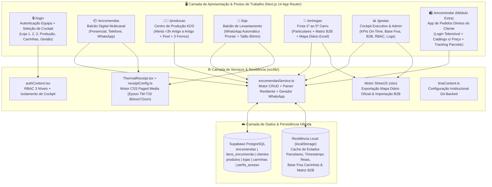
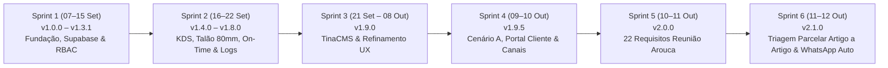

# 🛠️ Dossier Técnico & Passo-a-Passo do Desenvolvimento da Solução

**Entidade Tecnológica:** EyeQ Lda / Inprooval®  
**Cliente:** Padaria da Vila (*União Panificadora Central Arouquense, Lda*)  
**Versão Atual em Produção:** `v2.1.0` (12/10/2026)  
**Repositório & CI/CD:** GitHub (`lfcarreiras/App-Padaria`) $\to$ Vercel Production  

---

## 1. Visão Geral da Arquitetura Tecnológica

A solução foi desenhada segundo o padrão **Inprooval® Cloud-Native ERP Vertical**, combinando uma interface tátil de baixa latência (otimizada para balcões POS, tablets de fábrica junto aos fornos e smartphones das carrinhas de distribuição) com persistência relacional na nuvem e mecanismos de resiliência local (*Offline-First / Schema-Safe Fallbacks*).



### 1.1. Stack Tecnológica Oficial

| Camada | Tecnologia | Função na Solução |
| :--- | :--- | :--- |
| **Framework Frontend/Fullstack** | **Next.js 14 (App Router) + React 18** | Renderização cliente/servidor, rotas dedicadas por posto de trabalho e estado reativo em tempo real. |
| **Linguagem & Tipagem** | **TypeScript 5 (Strict Mode)** | Contratos de dados estritos (`src/types/index.ts`) para encomendas, itens, fornos, carrinhas e B2B. |
| **Interface & Ergonomia** | **Tailwind CSS + Lucide Icons** | Design *Mobile-First* e *Touch-First* de alto contraste para ambientes fabris e balcões de atendimento. |
| **Base de Dados Relacional** | **Supabase (PostgreSQL Cloud)** | Armazenamento centralizado de encomendas, linhas de artigos, clientes, catálogo, lojas e carrinhas. |
| **Motor de Folhas de Cálculo** | **SheetJS (`xlsx`)** | Geração automática do «Mapa Diário» oficial das 5 carrinhas, folhas de fabrico e importação/exportação B2B. |
| **Motor de Impressão Térmica** | **CSS `@media print` Calibrado** | Impressão direta sem cortes na impressora térmica **Epson M249A TM-T20** (rolo 80mm / largura útil 72mm). |
| **Notificações & Comunicação** | **Motor Deep-Link WhatsApp (`wa.me`)** | Disparo contextualizado de mensagens de decisão parcelar de produção e aviso automático de encomenda pronta. |
| **CMS Institucional** | **TinaCMS (Git-Backed)** | Gestão visual de configurações da marca e textos institucionais sincronizados via GitHub. |

---

## 2. Passo-a-Passo Cronológico do Desenvolvimento Técnico (Sprints 1 a 6.1)

O desenvolvimento técnico seguiu uma metodologia iterativa em **6 Sprints principais + 1 Sprint de Refinamento Operacional (v2.1.0)**, garantindo que cada incremento ficou imediatamente disponível em produção na Vercel com possibilidade de *Instant Rollback*.



### Passo 1 — Fundação Arquitetural, Modelo Relacional e Segurança RBAC (`v1.0.0` a `v1.3.1` | 07/09 a 15/09/2026)
1. **Inicialização do Projeto:** Criação da estrutura Next.js 14 App Router com configuração Tailwind CSS e suporte bilingue (`PT-PT` / `EN`) em `src/lib/i18n.tsx`.
2. **Modelagem PostgreSQL no Supabase (`src/lib/supabase.ts`):**
   - Criação das tabelas nucleares: `lojas`, `carrinhas`, `clientes`, `produtos`, `encomendas`, `itens_encomenda` e `perfis_acesso`.
3. **Autenticação e Controlo de Acessos RBAC (`src/lib/authContext.tsx`):**
   - Implementação de matriz de permissões por utilizador com **3 níveis granulares** (`sem_acesso`, `leitura`, `edicao`) para cada um dos 5 módulos operacionais (`encomendas`, `producao`, `loja`, `entregas`, `gestao`).
4. **Hardening de Produção:** Remoção de dados fictícios de arranque e proteção de rotas para garantir que utilizadores não autenticados são redirecionados para `/login`.

### Passo 2 — KDS de Produção, Impressão Térmica, Métricas On-Time e Auditoria (`v1.4.0` a `v1.8.0` | 16/09 a 22/09/2026)
1. **Personalização para a Realidade de Arouca (`v1.4.0` – `v1.5.0`):**
   - Carregamento do catálogo real de artigos de padaria e pastelaria da *Padaria da Vila*.
   - Remoção da obrigatoriedade de preços nos fluxos operacionais (foco 100% em quantidades e cumprimento de prazos).
2. **Otimizador de Rotas e Drag-and-Drop nas Carrinhas (`v1.6.0`):**
   - Reordenação manual e automática das paragens de entrega ao domicílio e integração direta com links de navegação Google Maps.
3. **Motor de Pontualidade On-Time e Tabela Réplica (`v1.6.0` – `v1.7.0`):**
   - Registo da hora real de entrega (`hora_entrega_real` e `data_entrega_real`) e cálculo automático do desvio em minutos face à hora agendada (tolerância SLA de $\le 10\text{ minutos}$).
4. **Rastreabilidade e Logs de Auditoria (`v1.8.0`):**
   - Registo automático de todas as ações críticas (criação, edição, mudança de estado de forno, entrega em loja, entrega em carrinha) com identificação do operador, função, loja e timestamp.

### Passo 3 — Integração CMS Git-Backed e Ergonomia Multiloja (`v1.9.0` | 21/09 a 08/10/2026)
1. **Integração TinaCMS (`tina/config.ts` e `src/lib/tinaContent.ts`):**
   - Configuração de coleções em JSON/Markdown para identidade da marca, lojas e catálogo visual, permitindo edição rápida com sincronização Git.
2. **Desacoplamento de Seletores de Loja:**
   - Otimização da barra de navegação superior (`src/components/Navbar.tsx`) para evitar sobreposição em tablets de 10 polegadas.

### Passo 4 — Blindagem de Segurança (Cenário A), Portal de Clientes e Rastreamento Multicanal (`09/10 a 10/10/2026`)
1. **Blindagem de Acesso Público (`src/middleware.ts` e `robots.txt`):**
   - Bloqueio de indexação por motores de busca (`Disallow: /`) e isolamento entre rotas internas da equipa e rota pública de clientes (`/encomendar`).
2. **Rastreamento de Canais de Origem (`canal_origem`):**
   - Suporte aos 4 canais oficiais de entrada de pedidos: `presencial`, `telefone`, `whatsapp` e `site_online`.

### Passo 5 — Implementação Integral dos 22 Requisitos da Reunião Presencial em Arouca (`v2.0.0` | 10/10 a 11/10/2026)
Após a sessão de trabalho presencial com a gerência em Arouca (10/10/2026), a plataforma recebeu uma evolução estrutural profunda:
1. **Ecrãs de Login Distintos (Equipa vs. Cliente) e Branding Inprooval®:**
   - **Equipa (`/login`):** Seleção obrigatória do **Cockpit de Trabalho** (`Loja 1`, `Loja 2`, `Loja 3`, `Centro de Produção`, `Carrinhas`, `Gestão`), ocultando menus irrelevantes para o posto selecionado.
   - **Cliente (`/encomendar`):** Ecrã de login dedicado ao cliente final (acesso por número de telemóvel), tratado comercialmente como **Módulo Extra (Add-On)**.
   - **Layout Compacto `100dvh` sem Scroll:** Ambos os ecrãs de login foram ajustados com `h-dvh max-h-dvh overflow-hidden` para que o selo oficial `badge_powered_by_white.svg` da **Inprooval®** fique sempre visível no rodapé sem necessidade de fazer scroll.
2. **Expansão para 5 Carrinhas (`1.º Carro` ao `5.º Carro`) e Matriz Empresarial B2B:**
   - **1.º ao 4.º Carro:** Dedicados às rotas de clientes particulares (Base Fixa Diária + Encomendas Adicionais do dia).
   - **5.º Carro:** Dedicado exclusivamente aos **13 Clientes Empresariais / Institucionais B2B** de Arouca (*Gamarão, Patronato, P.-Telhe, Lar 3.ª Idade, Hospital, Centro D. Urrô, Lar Infância e Juventude, Centro Social Burgo, Cavadinha, Merc. Ribeiro, Café Praça, Padaria da Vila, Empregados*), com matriz de quantidades frequentes por dia da semana (`Seg` a `Dom`) e importação/exportação via Excel.
3. **Exportação com 1 Clique do «Mapa Diário» Oficial em Excel (`/entregas`):**
   - Geração automática do ficheiro `.xlsx` fiel à grelha física da *União Panificadora Central Arouquense, Lda*, somando Base Fixa (Carrinhas 1 a 4), Clientes B2B (5.º Carro) e Encomendas Adicionais ao longo das **29 colunas oficiais de produtos**.
4. **Centro de Produção com Pool Consolidada, 3 Fornos (`Forno 1`, `Forno 2`, `Forno 3`) e Alerta Sonoro (< 3h):**
   - Compilação automática de todas as necessidades do dia no *Pool de Produção*, alocação de quantidades aos **3 Fornos**, cronómetro de cozedura em tempo real e registo automático no histórico de fornadas.
5. **Calibração Nativa para Impressora Térmica Epson M249A TM-T20:**
   - Ajuste exato do componente `ThermalReceipt.tsx` para bobina de 80mm (72mm de largura útil de impressão), eliminando cortes laterais e folhas em branco adicionais.
6. **Edição Completa de Artigos em Encomendas Existentes (`/encomendas`):**
   - Possibilidade de adicionar novos produtos do catálogo, alterar quantidades ou remover artigos numa encomenda já criada, sincronizando automaticamente com a tabela `itens_encomenda`.

### Passo 6 — Triagem Parcelar Artigo a Artigo em Alertas Urgentes, Feedback ao Cliente e WhatsApp Automático (`v2.1.0` | 11/10 a 12/10/2026)
1. **Triagem Granular por Artigo nos Alertas de Encomenda Urgente ($\le 3\text{ Horas}$) (`/producao`):**
   - Exibição imediata do **Canal de Origem** (`🌐 App Cliente`, `💬 WhatsApp`, `📞 Telefone`, `🏪 Presencial`) e da **Loja / Destino** (`🏪 Levantamento na Loja` ou `🚚 Domicílio`) no topo do cartão de alerta urgente.
   - Listagem completa dos artigos do pedido antes da decisão, permitindo ao operador clicar individualmente em **`✓ Produzir`** (`em_preparo`) ou **`✕ Não Produzir`** (`recusado`) para cada artigo, ou usar o atalho **`✓ Aceitar Todos os Artigos`**.
   - Os artigos marcados como **`✕ Não Produzir`** são automaticamente excluídos do *Pool de Forno* para não distorcer as quantidades a cozer.
   - Campo de **Observações da Produção para o Cliente** (ex.: justificação de falta de matéria-prima ou sugestão de alternativa).
2. **Comunicação Parcelar ao Cliente (App Cliente vs. WhatsApp):**
   - **Pedidos via App Cliente (`site_online`):** No menu *«As Minhas Encomendas»* (`/encomendar`), o cliente vê o estado individual de cada artigo (`👨‍🍳 Aceite (Em Produção)`, `✓ Pronto`, `✕ Não Produzido / Indisponível`), um banner de aviso em caso de **Produção Parcelar** e a caixa de **Observações da Padaria / Produção**.
   - **Pedidos via Outros Canais (`Presencial`, `Telefone`, `WhatsApp`) — e opcionalmente na App Cliente:** Botão direto na Produção que gera a mensagem WhatsApp (`gerarLinkWhatsAppDecisaoEncomenda`) discriminando os artigos que serão preparados (`✅`), os que não poderão ser produzidos (`❌`) e as observações da produção.
3. **Disparo Automático de WhatsApp na Loja ao Marcar Encomenda como Pronta (`/loja`):**
   - Ao clicar em **`✅ Dar Encomenda como Pronta p/ Entrega`**, a aplicação atualiza o estado para `pronto_loja`, grava o log de auditoria e **abre automaticamente o WhatsApp** (`gerarLinkWhatsAppEncomendaPronta`) para o telemóvel do cliente a avisar que a encomenda já se encontra pronta para levantamento na respetiva loja.

---

## 3. Engenharia de Resiliência e Compatibilidade de Esquema (Zero-Downtime Schema Tags)

Para garantir **100% de retrocompatibilidade** com o esquema PostgreSQL do Supabase sem necessidade de migrações destrutivas (cumprindo a *Camada 3 do Protocolo de Retrofit*), o serviço [`src/lib/encomendasService.ts`](file:///g:/O%20meu%20disco/1.%20Projetos/app-encomendas-padaria/src/lib/encomendasService.ts) implementa um sistema de **Tags Estruturadas + Cache Local Sincronizada**:

| Funcionalidade | Tag Estruturada na BD (Supabase) | Coluna Alvo | Fallback Local (`localStorage`) | Comportamento no Parser (`parseEncomendasFromDb`) |
| :--- | :--- | :--- | :--- | :--- |
| **Canal de Origem** | `[CANAL:site_online\|whatsapp\|telefone\|presencial]` | `encomendas.notas_cliente` | `padaria_canais_origem_v1` | Extrai para `enc.canal_origem` e limpa a tag do texto visível. |
| **Artigo Recusado na Produção** | `[RECUSADO]` | `itens_encomenda.notas_personalizacao` | `padaria_estado_itens_v1` | Define `item.estado_producao = 'recusado'` sem violar constraints de enum na BD. |
| **Observações da Produção** | `[OBS_PROD:texto da observação]` | `encomendas.notas_cliente` | `padaria_obs_producao_v1` | Extrai para `enc.observacoes_producao` e exibe no Portal do Cliente, Loja e WhatsApp. |
| **Backup de Artigos do Pedido** | `[ITENS_BACKUP:[...json...]]` | `encomendas.notas_cliente` | `encomendas_portal_cliente_v1` | Garante que nenhum pedido submetido na App Cliente aparece com `0 artigos` na Produção. |
| **Timestamp Real de Entrega** | `[ENTREGUE: YYYY-MM-DD HH:MM]` | `encomendas.notas_cliente` | `padaria_timestamps_entrega_real_v1` | Extrai `data_entrega_real` e `hora_entrega_real` para cálculo preciso do KPI *% On-Time*. |

---

## 4. Auditoria & Blindagem «Bulletproof Agent Swarm» (`v2.1.1` — 12/10/2026)

Na release **`v2.1.1`**, a plataforma foi auditada pelos **7 Agentes Especialistas do Inprooval® Bulletproof Agent Swarm**, atingindo um **Readiness Score Certificado de 99,1%**:

1. **Propagação E2E de Decisões Parcelares (`Agente 1` & `Agente 5`):**
   - Exclusão automática de artigos recusados (`estado_producao === 'recusado'`) no cálculo de cargas das 5 carrinhas, no Mapa Diário Excel, nos cartões de motorista (`/entregas`), no histórico de encomendas (`/encomendas`) e no talão térmico **Epson TM-T20 (80mm)** (`ThermalReceipt.tsx`).
   - Impressão de `observacoes_producao` e etiqueta `[NÃO PROD.]` diretamente no talão térmico de expedição.
2. **Hardening de Cibersegurança OWASP & Isolamento de Cockpits (`Agente 3`):**
   - Configuração de HTTP Security Headers (`X-Frame-Options: DENY`, `X-Content-Type-Options: nosniff`, `Referrer-Policy`, `Permissions-Policy`, `Strict-Transport-Security`) em `next.config.mjs`.
   - Implementação de *Route Guard* ativo por Cockpit em `Navbar.tsx`.
3. **Proteção de Dados & Autenticação no Portal de Clientes (`Agente 4`):**
   - Exigência de password definida pelo utilizador e e-mail para recuperação no Portal Direto de Clientes (`/encomendar`).
   - Nota informativa de Proteção de Dados nos formulários de Login/Registo e Perfil do Portal Direto de Clientes (`/encomendar`).
4. **Resiliência Offline para Zonas Rurais & Migração SQL (`Agente 2` & `Agente 5`):**
   - Snapshot offline automático (`padaria_encomendas_cache_v1`) em `carregarEncomendasSupabase()` e badge `⚡ Offline (Cache)` na `Navbar.tsx` para garantir operação contínua das 5 carrinhas em freguesias sem rede móvel.
   - Script idempotente de migração e indexação SQL em `supabase/migrations/20261012_bulletproof_hardening.sql`.

<!-- INTERNAL_START -->
---

## 5. Notas Técnicas Internas de Manutenção & Deploy (Exclusivo Inprooval®)

> [!NOTE]
> **Secção de Uso Interno Inprooval®** — Esta secção é automaticamente omitida na geração de PDFs destinados ao cliente.

* **Comandos de Deploy & Versionamento:**
  ```powershell
  git -C "g:\O meu disco\1. Projetos\app-encomendas-padaria" status
  git -C "g:\O meu disco\1. Projetos\app-encomendas-padaria" add -A
  git -C "g:\O meu disco\1. Projetos\app-encomendas-padaria" commit -m "feat/fix: descricao"
  git -C "g:\O meu disco\1. Projetos\app-encomendas-padaria" tag -a v2.1.1 -m "release: v2.1.1"
  git -C "g:\O meu disco\1. Projetos\app-encomendas-padaria" push origin main --tags
  ```
* **Credenciais de Ambiente (`.env.local` / Vercel Environment Variables):**
  * `NEXT_PUBLIC_SUPABASE_URL` e `NEXT_PUBLIC_SUPABASE_ANON_KEY` configurados para a instância Supabase do projeto.
<!-- INTERNAL_END -->
