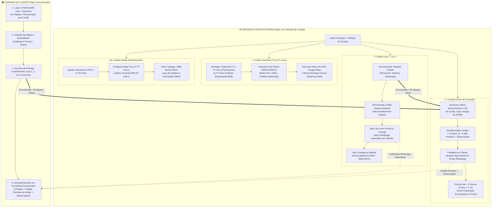

# 📘 Manual de Utilização, Jornadas por Perfil & Fluxos End-to-End de Cenários de Pedidos

**Entidade Tecnológica:** EyeQ Lda / Inprooval®  
**Cliente:** Padaria da Vila (*União Panificadora Central Arouquense, Lda*)  
**Versão:** `v2.1.3` (12/10/2026)  

---

## 1. Visão Geral dos Ecrãs de Acesso (Equipa vs. Cliente)

A plataforma separa de forma estrita a **Jornada Interna da Equipa** e a **Jornada Externa do Cliente Final**:

| Tipo de Utilizador | URL de Acesso | Método de Autenticação | Isolamento de Ecrã / Experiência |
| :--- | :--- | :--- | :--- |
| **Equipa Interna** (*Atendentes, Padeiros, Pasteleiros, Motoristas, Gerência*) | `/login` | Utilizador + Palavra-passe + **Seleção Obrigatória do Cockpit de Trabalho** (`Loja 1`, `Loja 2`, `Loja 3`, `Centro de Produção`, `Carrinhas`, `Gestão`) | Mostra apenas os menus e dados pertinentes ao posto de trabalho selecionado. |
| **Cliente Final** (*Módulo Extra: App de Pedidos Diretos*) | `/encomendar` | **Telemóvel (ou E-mail) + Password Definida pelo Utilizador** + **E-mail Obrigatório para Recuperação de Password** | Acesso exclusivo ao Catálogo de Quantidades (sem preços) e ao painel *«As Minhas Encomendas»*. |

---

## 2. Jornadas de Utilização Mapeadas em Fluxo (Por Perfil)

### 2.1. Mapa Global das Jornadas da Equipa e do Cliente

---

## 3. Passo-a-Passo Detalhado por Ecrã e Perfil de Utilizador

### 3.1. Perfil 1: Atendente de Balcão — Receção de Encomendas (`/encomendas`)
1. **Acesso:** Iniciar sessão em `/login`, introduzir as credenciais e selecionar o Cockpit da respetiva loja (`Loja 1 — Padaria da Vila`, `Loja 2 — Padaria da Praça` ou `Loja 3 — Padaria do Liceu`).
2. **Registar Nova Encomenda:**
   - **Passo 1 (Canal de Origem):** Selecionar o canal pelo qual o cliente fez o pedido: `🏪 Presencial`, `📞 Telefone` ou `💬 WhatsApp`.
   - **Passo 2 (Dados do Cliente):** Introduzir o telefone ou nome; se o cliente já existir, os dados (nome, morada, notas de entrega) preenchem-se automaticamente. Caso seja novo, fica gravado automaticamente ao submeter.
   - **Passo 3 (Modalidade de Entrega):**
     - **Levantamento em Loja:** Selecionar em qual das 3 lojas o cliente vai levantar.
     - **Entrega ao Domicílio:** Preencher a morada e selecionar a carrinha responsável (`1.º Carro` a `4.º Carro` para particulares, ou `5.º Carro` para reforços empresariais B2B).
   - **Passo 4 (Data e Hora):** Definir a data e hora pretendida de recolha/entrega.
   - **Passo 5 (Artigos e Personalizações):** Pesquisar ou filtrar artigos por setor (*Padaria* / *Pastelaria*), definir quantidades e adicionar notas específicas por artigo (ex.: *"Escrever Parabéns João"*, *"Fatiado"*, *"Sem açúcar"*).
   - **Passo 6 (Submissão e Impressão Térmica):** Clicar em **Gravar Encomenda**. Abre imediatamente o modal do **Talão Térmico (80mm)** pronto a imprimir na **Epson M249A TM-T20**.
3. **Editar Encomenda Existente (Adicionar ou Eliminar Artigos):**
   - Na secção inferior de *Histórico / Lista de Encomendas*, clicar no botão **✏️ Editar** de qualquer encomenda.
   - No modal de edição é possível:
     - **Alterar quantidades** (`+` / `-`) ou **eliminar artigos** existentes (ícone do caixote do lixo);
     - **Adicionar novos artigos** à encomenda pesquisando no seletor de produtos do catálogo;
     - Alterar data, hora, loja, carrinha ou canal de origem e clicar em **Guardar Alterações**.

---

### 3.2. Perfil 2: Operador de Fabrico — Centro de Produção & 3 Fornos (`/producao`)
1. **Acesso:** Iniciar sessão em `/login` e selecionar o Cockpit **`Centro de Produção`**.
2. **Triagem de Alertas de Encomenda Urgente ($\le 3\text{ Horas para Entrega}$):**
   - Sempre que existe uma encomenda agendada para as próximas 3 horas ainda não triada, o topo do ecrã apresenta um **Banner Vermelho Pulsante** acompanhado de **alerta sonoro de 10 segundos**.
   - **Informação Visível no Alerta:**
     - Código da encomenda, hora agendada, **Canal do Pedido** (`🌐 App Cliente`, `💬 WhatsApp`, `📞 Telefone`, `🏪 Presencial`) e **Loja / Destino** (`🏪 Levantamento na Loja: ...` ou `🚚 Domicílio: ...`).
     - **Conteúdo Completo do Pedido (Artigo a Artigo):** Lista todos os artigos e quantidades pedidos.
   - **Decisão Individual por Artigo (Produção Total ou Parcelar):**
     - Para cada artigo da lista, o operador clica em:
       - **`✓ Produzir`**: Aceita o artigo para fabrico (entra no *Pool de Forno* e muda para `Em Produção`).
       - **`✕ Não Produzir`**: Recusa apenas esse artigo (ex.: esgotou matéria-prima ou não há tempo de fermentação), retirando-o automaticamente dos cálculos de forno.
     - Em alternativa, pode clicar no botão rápido **`✓ Aceitar Todos os Artigos`** no topo do cartão.
   - **Observações e Feedback Imediato ao Cliente:**
     - O operador pode escrever uma nota no campo **«Observações p/ cliente»** (ex.: *"Não temos bolo rei hoje, mas os pães de centeio seguem às 17h"*).
     - **Se o pedido veio da App Cliente (`site_online`):** Clicar em **`Atualizar na App Cliente`** (o cliente passa a ver imediatamente na sua App quais os artigos aceites, quais os recusados e a observação da produção) ou, opcionalmente, clicar também em **`Enviar também via WhatsApp ao Cliente`**.
     - **Se o pedido veio de Presencial, Telefone ou WhatsApp:** Clicar no botão **`Enviar Estado Parcelar via WhatsApp ao Cliente`**, que abre automaticamente o WhatsApp com a mensagem formatada contendo a lista de artigos que serão produzidos (`✅`), os não produzidos (`❌`) e as observações.
   - Clicar em **`Concluir Triagem / Fechar Alerta`** para silenciar o alerta dessa encomenda.
3. **Gestão da Pool Consolidada do Dia e dos 3 Fornos (`Forno 1`, `Forno 2`, `Forno 3`):**
   - **Pool de Artigos a Produzir Hoje:** Soma automaticamente todas as necessidades do dia:
     $$\text{Pool do Dia} = \text{Encomendas Aceites} + \text{Base Fixa (1.º ao 4.º Carro)} + \text{Matriz Semanal B2B (5.º Carro)}$$
   - **Alocação aos 3 Fornos:** Em cada artigo da Pool, selecionar a quantidade a enviar e escolher **`Forno 1`**, **`Forno 2`** ou **`Forno 3`**.
   - **Controlo de Cozedura nos 3 Cartões de Forno:**
     - Clicar em **`🔥 Iniciar Preparação`**: Ativa o cronómetro em tempo real no respetivo forno.
     - Clicar em **`✅ Pronto`**: Conclui a fornada, regista a duração exata no **Histórico de Fornadas Concluídas Hoje** e liberta o forno.
4. **Vista Hierárquica (Artigo $\to$ Encomendas):**
   - Permite expandir qualquer artigo para ver a que clientes/encomendas se destina, alterar estados individuais ou enviar aviso WhatsApp ao cliente.

---

### 3.3. Perfil 3: Atendimento de Loja — Expedição e Levantamento (`/loja`)
1. **Acesso:** Iniciar sessão em `/login` com o Cockpit da loja (`Loja 1`, `Loja 2` ou `Loja 3`). O ecrã filtra automaticamente as encomendas daquela loja.
2. **Verificar Estado dos Artigos e Observações da Produção:**
   - Cada cartão de encomenda mostra os artigos a entregar. Se algum artigo tiver sido marcado como **`✕ Não Produzido`** pela produção, surge devidamente identificado a vermelho, juntamente com a caixa **💬 Observações da Produção**.
3. **Dar Encomenda como Pronta para Entrega (Disparo Automático de WhatsApp):**
   - Assim que os produtos chegam da produção para a prateleira da loja, o atendente clica no botão verde **`✅ Dar Encomenda como Pronta p/ Entrega (Abre WhatsApp ao Cliente)`**.
   - O sistema muda o estado para `3. Em Distribuição / Pronta na Loja` e **abre automaticamente o WhatsApp** com a mensagem pronta a enviar para o telemóvel do cliente a avisar que já pode passar na loja para levantar o seu pedido.
4. **Concluir Levantamento ao Balcão:**
   - Quando o cliente recolhe a encomenda na loja, clicar em **`✅ Entregar`**.
   - O sistema grava automaticamente a **Data Real e Hora Real de Levantamento** e muda o estado para `4. Entregue`.
5. **Ações Complementares:** Reimprimir o talão térmico (**`Reimprimir Talão`**) ou converter um levantamento em loja numa entrega ao domicílio (**`+ Domicílio`**).

---

### 3.4. Perfil 4: Motorista / Logística — Frota de 5 Carrinhas & Mapa Diário (`/entregas`)
1. **Acesso:** Iniciar sessão em `/login` com o Cockpit **`Carrinhas`**.
2. **Seleção da Carrinha (`1.º Carro` ao `5.º Carro`):**
   - **`1.º Carro` ao `4.º Carro` (Rotas de Particulares):** Apresentam o resumo consolidado da **Base Fixa Diária** daquela carrinha somado às **Encomendas Adicionais ao Domicílio** agendadas para esse dia.
   - **`5.º Carro` (Rota Exclusiva de Clientes Empresariais B2B):** Apresenta a tabela dos **13 Clientes Empresariais** com as quantidades fixas frequentes do dia da semana selecionado somadas a eventuais pedidos adicionais do dia.
3. **Exportação Oficial do Excel «MAPA DIÁRIO»:**
   - Clicar no botão **`📥 Exportar Excel «MAPA DIÁRIO»`** no topo do ecrã.
   - Descarrega imediatamente o ficheiro `.xlsx` formatado segundo a folha oficial da *União Panificadora Central Arouquense, Lda* (linhas `1.º CARRO` a `5.º CARRO`, subtotais, desdobramento individual dos 13 clientes empresariais do `5.º CARRO` e colunas dos 29 produtos oficiais + Totais).
4. **Execução da Rota e Registo de Entrega Real:**
   - Reordenar paragens por *Drag & Drop* ou usar o botão **Otimizar Rota**.
   - Clicar em **Abrir GPS (Google Maps)** para navegar até à morada do cliente.
   - Ao entregar o pão/pastelaria na porta do cliente, clicar em **`✅ Concluir Entrega`** — o sistema regista automaticamente a **Data e Hora Real da Entrega** para o cálculo de pontualidade (*% On-Time*).

---

### 3.5. Perfil 5: Cliente Final — App de Pedidos Diretos (`/encomendar`)
1. **Autenticação Segura com Password e E-mail de Recuperação:**
   - **Já sou Cliente (`Login`):** O cliente acede a `/encomendar` e introduz o seu **Número de Telemóvel (ou E-mail)** e a sua **Password**. (Caso o cliente já tenha ficha criada ao balcão da padaria mas seja o seu 1.º acesso online, o sistema redireciona automaticamente para definir a sua Password e E-mail de Recuperação).
   - **Novo Registo:** No primeiro acesso, o cliente indica **Telemóvel**, **Nome Completo**, **E-mail para Recuperação de Password** (obrigatório), define e confirma a sua **Password** (mínimo 4 caracteres) e morada opcional.
   - **Recuperar Password:** Caso se esqueça da password, o cliente clica em *«Recuperar»* (ou *«Esqueceu-se da password?»*), valida o seu **E-mail de Recuperação** (e telemóvel associado) e define de imediato uma nova password.
2. **Catálogo Exclusivo de Quantidades (Sem Preços):**
   - Navega pelos artigos de Padaria e Pastelaria, adiciona quantidades ao carrinho e escreve notas de personalização se desejar.
3. **Checkout Rápido:**
   - Escolhe entre **🏪 Levantamento na Loja** (selecionando Loja 1, Loja 2 ou Loja 3) ou **🚚 Entrega ao Domicílio** (confirmando a morada), indica a data e hora pretendida e submete o pedido.
4. **Acompanhamento em Tempo Real («As Minhas Encomendas»):**
   - Visualiza a barra de progresso de 4 etapas (`1. Encomendado` $\to$ `2. Em Produção` $\to$ `3. Em Distribuição` $\to$ `4. Entregue`).
   - Visualiza o **estado individual de cada artigo** (`👨‍🍳 Aceite (Em Produção)`, `✓ Pronto`, `✕ Não Produzido / Indisponível` ou `⏳ A aguardar confirmação`) e qualquer **Observação da Padaria / Produção**.

---

## 4. Fluxo End-to-End dos Cenários de Pedidos (Tipo de Cliente, Canal, Feedback Parcelar e Conclusão)

O diagrama abaixo mapeia passo a passo o que acontece a um pedido desde a sua entrada até à conclusão, consoante o **Tipo de Cliente (Particular vs. Empresarial B2B)**, o **Canal de Origem**, a **Decisão de Produção (Total vs. Parcelar vs. Recusada)**, o **Mecanismo de Feedback ao Cliente** e a **Modalidade de Entrega**:

```mermaid
flowchart TD
    Start(["📥 Entrada de Necessidade / Pedido"]) --> TipoCliente{"1. Tipo de Cliente?"}

    %% Ramo B2B Empresarial
    TipoCliente -->|"🏢 Cliente Empresarial B2B\n(13 Entidades - 5º Carro)"| OrigemB2B{"Como entra o pedido?"}
    OrigemB2B -->|"Matriz Recorrente Semanal\n(Seg a Dom em /gestao)"| PoolDia["👨‍🍳 Entra automaticamente na\nPool Consolidada do Dia (/producao)\ne no 5º Carro (/entregas)"]
    OrigemB2B -->|"Pedido Adicional / Extra\n(Telefone / WhatsApp / Balcão)"| RegistoInterno["Registo em /encomendas\ncom Canal + Alocação ao 5º Carro"]

    %% Ramo Particular
    TipoCliente -->|"👤 Cliente Particular"| CanalParticular{"2. Qual o Canal do Pedido?"}
    CanalParticular -->|"🏪 Presencial (Balcão)\n📞 Telefone\n💬 WhatsApp"| RegistoInterno
    CanalParticular -->|"🌐 App Cliente Online\n(/encomendar)"| SubmissaoApp["Grava no Supabase com\n[CANAL:site_online] + [ITENS_BACKUP]"]

    RegistoInterno --> CheckUrgencia{"3. Faltam ≤ 3 Horas\npara a Hora Agendada?"}
    SubmissaoApp --> CheckUrgencia

    CheckUrgencia -->|"Sim (Pedido Urgente)"| AlertaUrgente["🚨 Alerta Sonoro + Banner Vermelho\nMostra Canal + Loja/Destino + Lista de Artigos"]
    CheckUrgencia -->|"Não (> 3 Horas)"| VistaNormal["📋 Lista de Produção do Dia\n(Triagem em Vista Hierárquica / Pool)"]

    AlertaUrgente --> DecisaoArtigos{"4. Decisão da Produção\nArtigo a Artigo?"}
    VistaNormal --> DecisaoArtigos

    DecisaoArtigos -->|"✅ Todos os Artigos Aceites\n(✓ Produzir em todos)"| TodosAceites["Todos os artigos entram na Pool\ne nos 3 Fornos (Forno 1, 2, 3)\nEstado: 2. Em Produção"]
    DecisaoArtigos -->|"⚠️ Aceitação Parcelar\n(Alguns ✓ Produzir / Alguns ✕ Não Produzir)"| Parcelar["Apenas artigos aceites entram nos Fornos;\nArtigos recusados ficam [RECUSADO]\n+ Observações da Produção"]
    DecisaoArtigos -->|"❌ Todos Recusados\n(✕ Não Produzir em todos)"| TudoRecusado["Encomenda marcada como Cancelada/Não Produzida\nZero artigos enviados para o Forno"]

    TodosAceites --> FeedbackCanal{"5. Qual o Canal para\nFeedback de Status ao Cliente?"}
    Parcelar --> FeedbackCanal
    TudoRecusado --> FeedbackCanal

    FeedbackCanal -->|"🌐 Canal = App Cliente\n(site_online)"| FeedbackApp["📱 Atualização Imediata em 'As Minhas Encomendas':\n• Badge individual por artigo (Aceite vs Não Produzido)\n• Aviso de Produção Parcelar + Caixa de Observações\n• (+ Botão WhatsApp opcional na Produção)"]
    FeedbackCanal -->|"🏪 Presencial / 📞 Telefone / 💬 WhatsApp"| FeedbackWA["📲 Botão 'Enviar Estado Parcelar via WhatsApp':\nAbre WhatsApp para o telemóvel do cliente com:\n• Lista de artigos em preparação (✅)\n• Lista de artigos indisponíveis (❌)\n• Observações da Produção"]

    FeedbackApp --> CozeduraFornos["🔥 Cozedura nos 3 Fornos (/producao)\nIniciar Preparação (Cronómetro) ➔ Pronto"]
    FeedbackWA --> CozeduraFornos
    PoolDia --> CozeduraFornos

    CozeduraFornos --> DestinoEntrega{"6. Como é Entregue e\nDado como Concluído?"}

    DestinoEntrega -->|"🏪 Levantamento em Loja\n(Loja 1, Loja 2 ou Loja 3)"| FluxoLoja["1. Loja clica '✅ Dar como Pronta p/ Entrega':\n   Muda p/ 3. Em Distribuição e ABRE WHATSAPP AUTOMÁTICO\n   a avisar o cliente que está pronta na loja.\n2. Cliente levanta no balcão ➔ Loja clica 'Entregar':\n   Grava Data/Hora Real e muda p/ 4. Entregue."]

    DestinoEntrega -->|"🚚 Entrega ao Domicílio\n(1º ao 4º Carro Particulares\nou 5º Carro B2B)"| FluxoCarrinha["1. Extração do Excel «MAPA DIÁRIO» (/entregas)\n2. Carga da Carrinha (Estado: 3. Em Distribuição)\n3. Navegação GPS Google Maps até à morada\n4. Motorista clica 'Concluir Entrega':\n   Grava Data/Hora Real, calcula % On-Time e muda p/ 4. Entregue."]
```

---

### 4.1. Matriz Resumo de Todos os Cenários Operacionais de Pedidos

| Cenário | Tipo de Cliente | Canal de Entrada | Onde Entra na App | Triagem na Produção (`/producao`) | Como o Cliente Recebe o Feedback de Produção | Entrega Final e Fecho (`4. Entregue`) |
| :--- | :--- | :--- | :--- | :--- | :--- | :--- |
| **Cenário 1: Pedido Particular Online (Total ou Parcelar)** | Particular | 🌐 **App Cliente (`/encomendar`)** | Submetido diretamente pelo cliente no telemóvel (sem preços). | Se $\le 3\text{h}$, dispara **Alerta Urgente**. Padeiro aceita todos ou decide artigo a artigo (`✓ Produzir` / `✕ Não Produzir`) + escreve Observações. | **Automático na App Cliente** (menu *«As Minhas Encomendas»* mostra estado artigo a artigo + Observações) + **WhatsApp opcional**. | **Na Loja:** Botão *«Pronta p/ Entrega»* abre WhatsApp automático ao cliente $\to$ *«Entregar»* no levantamento. **Ao Domicílio:** Carrinha 1 a 4 entrega na morada com GPS. |
| **Cenário 2: Pedido Particular via WhatsApp / Telefone / Balcão** | Particular | 💬 **WhatsApp** 📞 **Telefone** 🏪 **Presencial** | Registado pela atendente em `/encomendas` com seleção do respetivo canal. | Se $\le 3\text{h}$, dispara **Alerta Urgente** com indicação do Canal e Loja. Padeiro decide artigo a artigo e adiciona Observações. | **Via Botão WhatsApp na Produção:** Gera mensagem automática para o telemóvel do cliente com os artigos aceites (`✅`), recusados (`❌`) e observações. | **Na Loja:** Botão *«Pronta p/ Entrega»* abre WhatsApp automático ao cliente $\to$ *«Entregar»*. **Ao Domicílio:** Carrinha 1 a 4 entrega na morada. |
| **Cenário 3: Rota Fixa Diária de Particulares (Pão Quente Porta-a-Porta)** | Particular (Assinatura / Base Fixa) | 🔄 **Base Fixa Diária (`1.º ao 4.º Carro`)** | Parametrizado pela Gerência na grelha de Base Fixa em `/gestao`. | Entra automaticamente na **Pool Consolidada do Dia** e nos **3 Fornos** sem necessidade de criar encomenda manual. | Não aplicável (entrega diária contratada). | Compilado automaticamente nas linhas `1.º CARRO` a `4.º CARRO` do Excel **«MAPA DIÁRIO»** em `/entregas`. |
| **Cenário 4: Fornecimento Regular a Clientes Empresariais (B2B)** | Empresarial / Institucional (13 Clientes) | 🏢 **Matriz Semanal B2B (`5.º Carro`)** | Parametrizado por dia da semana (`Seg` a `Dom`) ou via importação Excel em `/gestao`. | Entra automaticamente na **Pool Consolidada do Dia** para fabrico nos 3 Fornos. | Caso haja ajuste pontual, notificação direta por telefone/WhatsApp. | Compilado no **`5.º Carro`** em `/entregas` e desdobrado cliente a cliente no Excel **«MAPA DIÁRIO»**. |
| **Cenário 5: Pedido Adicional / Extra de Cliente Empresarial (B2B)** | Empresarial / Institucional | 📞 **Telefone** 💬 **WhatsApp** | Registado em `/encomendas` atribuído ao **`5.º Carro`** (ou adicionado na vista do 5.º Carro). | Se $\le 3\text{h}$, dispara **Alerta Urgente**; soma-se automaticamente às quantidades fixas do dia desse cliente B2B. | Confirmação total ou parcelar enviada via **Botão WhatsApp** na Produção. | Soma-se na linha do respetivo cliente empresarial no **`5.º Carro`** e no Excel **«MAPA DIÁRIO»**. |
