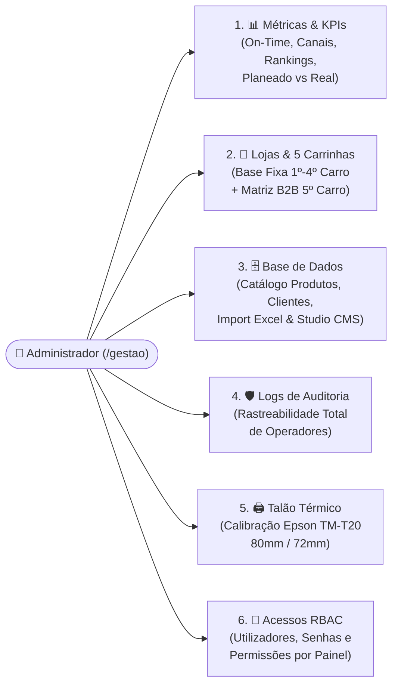

# 📊 Manual do Administrador: Configurações & Fórmulas de Indicadores do Cockpit de Gestão

**Entidade Tecnológica:** EyeQ Lda / Inprooval®  
**Cliente:** Padaria da Vila (*União Panificadora Central Arouquense, Lda*)  
**Rota de Acesso:** `/gestao` (Exclusivo para Perfil **Administrador / Gerência**)  
**Versão:** `v2.3.4` (18/10/2026)  

---

## 1. Estrutura do Cockpit de Gestão (`/gestao`)

O utilizador com perfil **Administrador** seleciona no login o Cockpit **`Gestão`** (tendo também acesso livre a todos os restantes painéis operacionais e ao filtro global **«Todas as Lojas»**). O Cockpit de Gestão divide-se em **6 Abas de Controlo**:

---

## 2. Aba 1: Métricas, Indicadores Operacionais (KPIs) & Fórmulas de Cálculo

Todos os indicadores do Cockpit de Gestão são **reativos em tempo real** aos **3 Filtros Globais de Contexto** situados no topo do painel:

1. **Filtro de Loja (`selectedLojaId`):** `Todas as Lojas`, `Loja 1 — Padaria da Vila`, `Loja 2 — Padaria da Praça`, `Loja 3 — Padaria do Liceu`.
2. **Filtro de Formato de Entrega (`formatoEntrega`):** `Todos os Formatos`, `🏪 Levantamento em Loja` (`levantamento_loja`), `🚚 Entrega ao Domicílio` (`entrega_domicilio`).
3. **Filtro Temporal (`periodoSelecionado`):**
   - **Hoje (`dia`):** $D_{\text{agendamento}} = D_{\text{hoje}}$
   - **Semana (`semana`):** $D_{\text{hoje}} - 7\text{ dias} \le D_{\text{agendamento}} \le D_{\text{hoje}}$
   - **Mês (`mes`):** $D_{\text{agendamento}} \ge \text{Dia 1 do Mês Corrente}$
   - **Ano (`ano`):** $D_{\text{agendamento}} \ge \text{1 de Janeiro do Ano Corrente}$
   - **Histórico Completo (`todos`):** Sem restrição de data.

Seja $\mathcal{E}$ o subconjunto de encomendas que satisfaz simultaneamente os 3 filtros ativos. Abaixo detalham-se todos os indicadores e a respetiva **fórmula matemática de cálculo**:

---

### 2.1. Indicadores de Volume e Capacidade Operacional

| Indicador (KPI) | Fórmula Matemática de Cálculo | Significado Operacional e Regra de Negócio |
| :--- | :--- | :--- |
| **1. Volume Total de Encomendas ($N_{\text{total}}$)** | $$N_{\text{total}} = \|\mathcal{E}\|$$ | Número total de encomendas agendadas para o período, loja e formato selecionados. |
| **2. Total de Artigos Encomendados ($Q_{\text{total}}$)** | $$Q_{\text{total}} = \sum_{e \in \mathcal{E}} \sum_{i \in \text{itens}(e)} q_i$$ | Soma de todas as unidades ($q_i$) de produtos de padaria e pastelaria incluídas nas encomendas filtradas. |
| **3. Total de Levantamentos em Loja ($N_{\text{loja}}$)** | $$N_{\text{loja}} = \|\{e \in \mathcal{E} : e.\text{tipo} = \text{'levantamento\_loja'}\}\|$$ $$\%_{\text{loja}} = \frac{N_{\text{loja}}}{N_{\text{total}}} \times 100$$ | Quantidade e peso percentual de pedidos recolhidos diretamente nos balcões das 3 lojas. |
| **4. Total de Entregas ao Domicílio ($N_{\text{dom}}$)** | $$N_{\text{dom}} = \|\{e \in \mathcal{E} : e.\text{tipo} = \text{'entrega\_domicilio'}\}\|$$ $$\%_{\text{dom}} = \frac{N_{\text{dom}}}{N_{\text{total}}} \times 100$$ | Quantidade e peso percentual de pedidos expedidos através da frota de carrinhas. |

---

### 2.2. Indicador de Nível de Serviço e Pontualidade (`% On-Time Delivery`)

Este é o indicador crítico de qualidade de serviço da *Padaria da Vila*, comparando a **Hora Agendada pelo Cliente ($H_{\text{plan}}, M_{\text{plan}}$)** com a **Hora Real de Entrega/Levantamento ($H_{\text{real}}, M_{\text{real}}$)** registada automaticamente quando o balcão (`/loja`) ou o motorista (`/entregas`) conclui a entrega:

1. **Cálculo do Desvio Temporal em Minutos ($\Delta t_e$):**
   $$\Delta t_e = (H_{\text{real}} \times 60 + M_{\text{real}}) - (H_{\text{plan}} \times 60 + M_{\text{plan}})$$
   - Se $\Delta t_e \le 0$: Entregue **antes ou exatamente na hora agendada** (Ex.: `-5 min`).
   - Se $0 < \Delta t_e \le +10$: Entregue **dentro da tolerância operacional de 10 minutos** (considerado **No Prazo / On-Time**).
   - Se $\Delta t_e > +10$: Entregue **Com Atraso** (Ex.: `+18 min`, sinalizado a vermelho na tabela consolidada).

2. **Fórmula da Taxa de Pontualidade (`% On-Time`):**
   Seja $\mathcal{E}_{\text{entregues}} = \{e \in \mathcal{E} : e.\text{estado} = \text{'entregue'}\}$ o conjunto de encomendas já concluídas:
   $$\%\text{ On-Time} = \text{round}\left( \frac{\|\{e \in \mathcal{E}_{\text{entregues}} : \Delta t_e \le +10\text{ min}\}\|}{\|\mathcal{E}_{\text{entregues}}\|} \times 100 \right)$$
   *(Nota: Caso ainda não existam entregas concluídas no filtro selecionado, $\%\text{ On-Time}$ assume o valor base de $100\%$).*

---

### 2.3. Indicadores de Canais de Origem (`canaisOrigemStats`)

Mede a tração de cada canal de entrada de encomendas no período filtrado:

| Canal de Origem | Código Técnico | Fórmula de Contagem e Quota (%) |
| :--- | :--- | :--- |
| **🏪 Presencial (Balcão)** | `presencial` | $$N_{\text{pres}} = \|\{e \in \mathcal{E} : e.\text{canal\_origem} = \text{'presencial'}\}\|, \quad \%_{\text{pres}} = \frac{N_{\text{pres}}}{N_{\text{total}}} \times 100$$ |
| **📞 Telefone / Chamada** | `telefone` | $$N_{\text{tel}} = \|\{e \in \mathcal{E} : e.\text{canal\_origem} = \text{'telefone'}\}\|, \quad \%_{\text{tel}} = \frac{N_{\text{tel}}}{N_{\text{total}}} \times 100$$ |
| **💬 WhatsApp** | `whatsapp` | $$N_{\text{wa}} = \|\{e \in \mathcal{E} : e.\text{canal\_origem} = \text{'whatsapp'}\}\|, \quad \%_{\text{wa}} = \frac{N_{\text{wa}}}{N_{\text{total}}} \times 100$$ |
| **🌐 App Cliente (Online)** | `site_online` | $$N_{\text{online}} = \|\{e \in \mathcal{E} : e.\text{canal\_origem} = \text{'site\_online'}\}\|, \quad \%_{\text{online}} = \frac{N_{\text{online}}}{N_{\text{total}}} \times 100$$ |

---

### 2.4. Rankings Operacionais e Necessidades Consolidadas de Produção

1. **Top 5 Clientes com Mais Encomendas (`topClientes`):**
   - Agrupa as encomendas filtradas por chave única de cliente ($\text{Telefone} \lor \text{Nome}$), soma o número de encomendas realizadas por cada cliente e ordena de forma decrescente, exibindo os 5 primeiros.
2. **Top 5 Artigos Mais Pedidos (`topArtigos`):**
   - Soma as quantidades ($q_i$) por `produto_nome` em todas as encomendas filtradas e ordena de forma decrescente, destacando os 5 produtos de maior rotação e o respetivo setor (`padaria` vs. `pastelaria`).
3. **Necessidades Consolidadas de Produção & Exportação de Folhas de Fabrico Excel:**
   - Agrega todas as quantidades necessárias por artigo e setor.
   - Inclui botões de exportação direta para Excel (`.xlsx`) separados por **Folha de Fabrico — Padaria** e **Folha de Fabrico — Pastelaria**.
4. **Tabela Consolidada «Planeado vs. Real»:**
   - Grelha auditável linha a linha com pesquisa e ordenação por: `Código`, `Cliente`, `Formato`, `Data Planeada`, `Hora Planeada`, `Data Real`, `Hora Real`, `Desvio / Pontualidade` (`No Prazo`, `Com Atraso`, `Pendente`), `Estado` e ações de **Editar** ou **Eliminar** encomenda.

---

## 3. Aba 2: Configuração das Lojas, Frota de Carrinhas, Base Diária & Clientes Empresariais B2B (`lojas_carrinhas`)

Esta aba centraliza toda a parametrização logística da *Padaria da Vila*:

### 3.1. Gestão das Lojas Físicas e Frota de Carrinhas
- **Lojas Físicas:** Criação (`+ Nova Loja`) e Edição de Nome, Código, Morada, Telefone, NIF e estado Ativo/Inativo das lojas físicas (`Padaria da Vila`, `Padaria da Praça`, `Padaria do Liceu`, etc.).
- **Frota de Carrinhas:** Criação (`+ Nova Carrinha`) e Edição do Identificador (`1.º Carro` a `5.º Carro`), Matrícula, Capacidade em Caixas/Kgs, Loja Base e estado Ativo/Inativo.

### 3.2. Grelha da Base Fixa Diária de Particulares (`1.º ao 4.º Carro`)
- Permite definir e gerir tanto a **lista de artigos** como as **quantidades globais fixas diárias** que cada uma das carrinhas de rota particular leva diariamente para venda e distribuição porta-a-porta.
- **Separação Logística Estrita da Carrinha 5 (`v2.3.4`):** A Carrinha 5 (`55-EM-26`) não surge na Base Diária comum de carrinhas, uma vez que está 100% alocada às entregas institucionais da matriz B2B (*5.º Carro*).
- **Edição Total de Artigos e Quantidades:**
  1. **Edição Direta de Quantidades:** Células numéricas interativas para digitação rápida de valores por carrinha e por dia da semana (`Seg` a `Dom`), com botão **«Guardar Quantidades»**.
  2. **Replicação Instantânea de Dia:** Botão **«Replicar dia p/ toda a semana»** para replicar as quantidades do dia selecionado por toda a semana.
  3. **Adicionar Artigos:** Botão **«+ Escolher artigo do catálogo»** (com seleção modal e pesquisa) e botão **«+ Adicionar novo artigo»** (com digitação manual).
  4. **Editar e Eliminar Artigos:** Edição do nome do artigo com propagação automática e eliminação de artigos com ícone de caixote do lixo (`🗑️`).
  5. **Extração e Importação Excel:** Extração com 1 clique da Base Fixa (`.xlsx`) consolidada (1.º ao 4.º Carro) ou individual por carrinha, e importação de folhas Excel atualizadas.
  6. **Impacto Automático:** Todas as alterações refletem-se imediatamente na **Pool Consolidada do Dia** em `/producao` e no ficheiro Excel **«MAPA DIÁRIO»** em `/entregas`.

### 3.3. Matriz Semanal dos Clientes Empresariais B2B (`5.º Carro`)
- Parametriza as quantidades fixas diárias entregues pelo **`5.º Carro`** às entidades empresariais/institucionais de Arouca (*Hospital, Patronato, Centros Sociais, Lares, Cafés e Mercearias*).
- **Simplificação Operacional (`v2.3.4`):** Remoção da coluna redundante "ROTA / CARRINHA" da grelha B2B, com indicação clara de distribuição exclusiva e integral pela Carrinha 5.
- **Edição Total de Clientes e Artigos B2B:**
  1. **Criação e Edição de Clientes:** Botão **«+ Novo Cliente Empresarial»** e botão **«Editar»** para ajustar nome, morada e telefone.
  2. **Edição Direta de Quantidades:** Inputs numéricos em cada célula de produto com atualização em tempo real.
  3. **Eliminação Segura de Clientes:** Eliminação de clientes empresariais tanto pelo botão de ação na linha (`🗑️`) como pelo botão no rodapé do modal de edição, sempre com confirmação do utilizador.
  4. **Replicação Semanal por Cliente:** Botão **«Replicar dia p/ toda a semana»** no modal e na tabela para propagar quantidades de um dia para todos os dias úteis e fins de semana.
  5. **Exportação e Importação Excel:** Template Excel dedicado e upload em lote para atualização rápida.

---

## 4. Aba 3: Base de Dados, Catálogo de Produtos & Importação Massiva (`database`)

1. **Catálogo de Artigos com Gestão Integrada (`v2.3.4`):**
   - Eliminação do cabeçalho avulso "+ Inserir Registo na Base de Dados" para um design mais limpo e ergonómico.
   - Botão **«+ Novo Artigo»** posicionado diretamente no cabeçalho do Catálogo de Artigos.
   - Pesquisa em tempo real por nome, filtro por Categoria (`Padaria` / `Pastelaria`), Unidade (`unidade` / `kg`) e Estado (`Ativo` / `Inativo`).
   - **Normalização Automática Title Case (`formatarNomeEntidade`):** Qualquer produto inserido ou importado em maiúsculas é automaticamente formatado com ortografia portuguesa e acentuação correta.
2. **Importação e Exportação Massiva em Excel/CSV:**
   - Suporte a ficheiros `.xlsx`, `.xls` e `.csv` para atualização em lote de **Produtos** ou **Clientes**, com pré-visualização antes da confirmação.
3. **Studio CMS Visual Nativo (`/cms`):**
   - Editor visual integrado da solução (`/cms`) para gestão de conteúdos institucionais e textos de interface sincronizados com o GitHub.

---

## 5. Aba 4: Histórico & Logs de Auditoria de Utilizadores (`logs`)

Garante **rastreabilidade total (Accountability)** de todas as operações realizadas na plataforma:
- **4 Indicadores Rápidos de Auditoria (KPIs de Topo):**
  1. `Ações Auditadas` (total de eventos filtrados),
  2. `Ações de Hoje` (operações realizadas no próprio dia),
  3. `Colaboradores Ativos` (número de operadores distintos com atividade registada),
  4. `Entregas Concluídas` (total de encomendas marcadas como entregues no registo).
- **Campos Registados por Evento:** `Data e Hora Exata`, `Código da Encomenda` (clicável para abrir a pré-visualização e impressão do talão térmico), `Nome do Cliente`, `Utilizador (Nome + Role)`, `Painel de Origem` (`encomendas`, `producao`, `loja`, `entregas`, `gestao`), `Ação Executada` e `Detalhes Completos`.
- **Filtros Avançados:** Pesquisa por código de encomenda, cliente, operador específico, perfil/função, painel, tipo de ação e atalhos rápidos (`Todo o Histórico`, `Hoje`, `Ontem`, `Últimos 7 Dias` ou datas personalizadas), com paginação configurável (`25`, `50`, `100` ou `Todos`).

---

## 6. Aba 5: Configurador do Talão Térmico (`talao`)

Permite personalizar o layout do talão impresso nas lojas sem necessidade de intervenção técnica:
- **Configuração Individual por Loja Física (`v2.3.4`):** Seletor de loja física (`Geral (Todas as Lojas)` ou loja específica), permitindo que cada loja tenha o seu próprio cabeçalho comercial, telefone, morada, NIF e mensagem de rodapé, com fallback transparente para a configuração global.
- **Largura do Papel:** Configurado por defeito para **80mm (72mm de largura útil — Calibrado para Epson M249A TM-T20)**, com suporte alternativo para bobinas de **58mm**.
- **Campos Editáveis:** Nome da Empresa, Slogan / Subtítulo, Morada, Telefone, NIF, Mensagem de Rodapé, Tamanho de Letra (`Compacto`, `Médio`, `Grande`) e interruptores para mostrar/ocultar NIF, Morada, Telefone, Separação Padaria/Pastelaria, Destaque de Notas de Bolo e **QR Code no rodapé (`showQrCode`)**.
- **Suporte Automático a Produção Parcelar:** O talão assinala automaticamente artigos recusados com `[NÃO PROD.]`, exclui-os do somatório de unidades entregues e imprime as `Observações da Produção`.
- **Pré-visualização ao Vivo & Teste de Impressão:** Mostra em tempo real no ecrã como ficará o talão térmico calibrado e permite emitir um talão de teste instantâneo.

---

## 7. Aba 6: Gestão de Acessos & Permissões RBAC (`acessos`)

Permite ao Administrador gerir toda a equipa e controlar o que cada colaborador pode ver ou editar:
- **Gestão Total de Utilizadores (`v2.3.4`):** Desbloqueio integral dos botões **«+ Novo Utilizador»**, **«Editar»** e **«Eliminar»** (`🗑️`), permitindo gerir a lista de colaboradores sem restrições.
- **Campos de Utilizador:** Nome, Email/Username, Palavra-passe, Função (`admin`, `gerente_loja`, `atendente`, `operador_padaria`, `operador_pastelaria`, `motorista`) e estado (`Ativo` / `Inativo`).
- **Matriz de Permissões Granulares por Painel & Route Guard por Cockpit:** Para cada utilizador, define-se individualmente o nível de acesso aos 5 módulos (`Encomendas`, `Produção`, `Loja`, `Entregas`, `Gestão`):
  - **`🚫 Sem Acesso` (`sem_acesso`):** O menu não aparece na barra de navegação e a rota está bloqueada por *Route Guard* automático.
  - **`👁️ Apenas Leitura` (`leitura`):** O utilizador pode consultar o ecrã, mas todos os botões de ação/gravação ficam desativados.
  - **`✏️ Edição Total` (`edicao`):** O utilizador pode executar todas as operações daquele painel.
