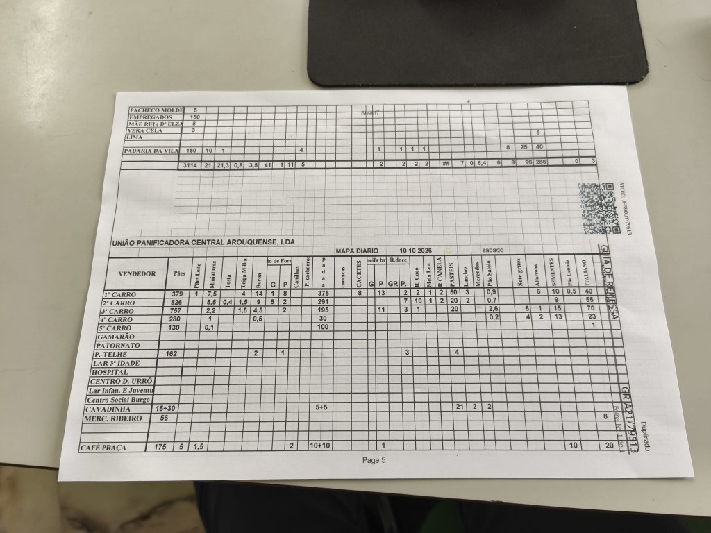
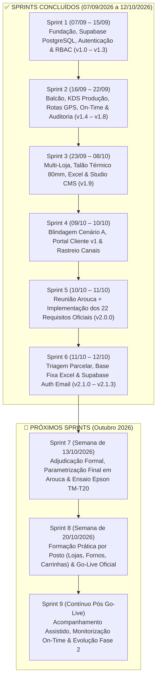

# 📋 Dossier Mestre do Projeto: Cliente, Requisitos, Backlog, Orçamento, Sprints & Oportunidades Futuras

**Entidade Prestadora:** EyeQ Lda / Inprooval®  
**Consultor Responsável:** Luís Carreiras  
**Cliente:** Padaria da Vila (*União Panificadora Central Arouquense, Lda*)  
**Data de Início do Projeto:** 07/09/2026  
**Última Atualização:** 12/10/2026 (`v2.1.3`)  

---

## 1. Ficha do Cliente e Contexto do Projeto

| Campo | Detalhe |
| :--- | :--- |
| **Designação Social / Marca** | **União Panificadora Central Arouquense, Lda** (*Padaria da Vila*) |
| **Localização Geográfica** | Arouca, Portugal |
| **Estrutura Comercial (3 Lojas)** | • **Loja 1:** Padaria da Vila (Sede / Matriz) • **Loja 2:** Padaria da Praça • **Loja 3:** Padaria do Liceu |
| **Estrutura Fabril** | Centro de Produção próprio (Padaria e Pastelaria) equipado com **3 Fornos (`Forno 1`, `Forno 2`, `Forno 3`)** |
| **Frota de Distribuição (5 Carrinhas)** | • **`1.º Carro` a `4.º Carro`:** Rotas de distribuição porta-a-porta a clientes particulares (Base Fixa Diária + Encomendas Adicionais) • **`5.º Carro`:** Rota exclusiva para **13 Clientes Empresariais e Institucionais (B2B)** em Arouca (*Gamarão, Patronato, P.-Telhe, Lar 3.ª Idade, Hospital, Centro D. Urrô, Lar Infância e Juventude, Centro Social Burgo, Cavadinha, Merc. Ribeiro, Café Praça, Padaria da Vila, Empregados*) |
| **Hardware de Balcão Validado** | Impressora Térmica de Talões **Epson M249A TM-T20** (rolo térmico 80mm / área útil 72mm) |
| **Data de Arranque (Kick-off)** | **07/09/2026** (Reunião Online de Levantamento Inicial) |
| **Marco Presencial Chave** | **10/10/2026** (Reunião Presencial em Arouca das 10:30 às 12:15 — Demonstração ao vivo e recolha dos 22 requisitos finos) |

---

## 2. O Problema a Resolver (Dores Operacionais Diagnosticadas & Processo *As-Is*)

1. **Fragmentação de Encomendas Multicanal:** Pedidos recebidos presencialmente nos 3 balcões, por telefone e por WhatsApp apontados em papel, gerando falhas de comunicação com o fabrico, dificuldade em editar pedidos já registados e ausência de confirmação estruturada ao cliente quando algum artigo já não pode ser produzido.
2. **Falta de Visibilidade de Urgências (< 3 Horas) e Ocupação dos 3 Fornos:** Encomendas de última hora para o próprio dia sem alarme imediato na fábrica e necessidade de controlar o que está a cozer em cada um dos **3 Fornos** e os respetivos tempos de fornada.
3. **Trabalho Manual Diário no «Mapa Diário» das 5 Carrinhas ($45\text{ min/dia} \times 363\text{ dias} = 272,25\text{ horas/ano}$):** Todos os dias ($363\text{ dias/ano}$), um funcionário demora **$45\text{ minutos}$** a recolher todos os pedidos manuais em papel e a criar a tabela em Excel (`MAPA DIARIO`). A digitalização e automatização deste processo liberta **$272,25\text{ horas/ano}$** ($\approx 22,7\text{ horas/mês}$).
4. **Necessidade de Isolamento por Posto de Trabalho:** Cada equipa (`Loja 1`, `Loja 2`, `Loja 3`, `Centro de Produção`, `Carrinhas` e `Gestão`) precisa de um ecrã limpo e focado apenas na sua função, sem menus desnecessários.

---

## 3. Principais Requisitos & Backlog Completo do Produto (Desenvolvido vs. Futuro)

A tabela seguinte apresenta o **Backlog Integral do Produto**, discriminando o que já se encontra **100% desenvolvido e publicado em produção (`v2.1.3`)** face aos itens em **Backlog Futuro (Fase 2 e Fase 3)**:

| ID Req. | Módulo / Épico | Descrição do Requisito Funcional | Âmbito Orçamental | Estado Atual | Versão |
| :---: | :--- | :--- | :---: | :---: | :---: |
| **REQ-01** | Autenticação & Cockpit | Login da equipa (`/login`) com seleção obrigatória de Cockpit (`Loja 1`, `Loja 2`, `Loja 3`, `Produção`, `Carrinhas`, `Gestão`), isolamento de menus e rodapé *Powered by Inprooval* visível sem scroll (`100dvh`). | Base | ✅ **Desenvolvido** | `v2.0.0` |
| **REQ-02** | Balcão Multicanal | Registo de encomendas (`/encomendas`) com canal de origem (`Presencial`, `Telefone`, `WhatsApp`), pesquisa/criação automática de cliente e agendamento de data/hora. | Base | ✅ **Desenvolvido** | `v1.9.5` |
| **REQ-03** | Edição de Encomendas | Edição completa de encomendas após pedido inicial: adicionar novos artigos do catálogo, eliminar artigos ou alterar quantidades, loja e carrinha. | Base | ✅ **Desenvolvido** | `v2.0.0` |
| **REQ-04** | Impressão Epson TM-T20 | Talão térmico calibrado nativamente para **Epson M249A TM-T20** (bobina 80mm / 72mm úteis), sem preços e sem páginas em branco. | Base | ✅ **Desenvolvido** | `v2.0.0` |
| **REQ-05** | Produção: Alerta Urgente $\le 3\text{h}$ & Triagem Parcelar | Alarme sonoro (10s) e banner vermelho para encomendas a $\le 3\text{h}$, exibindo Canal, Loja/Destino e lista de artigos com decisão individual **`✓ Produzir` / `✕ Não Produzir`** por artigo + Observações da Produção. | Base | ✅ **Desenvolvido** | `v2.1.0` |
| **REQ-06** | Produção: Feedback WhatsApp ao Cliente | Botão na Produção para enviar via WhatsApp ao cliente o estado parcelar da encomenda (artigos aceites `✅`, artigos não produzidos `❌` e observações). | Base | ✅ **Desenvolvido** | `v2.1.0` |
| **REQ-07** | Produção: Pool Consolidada & 3 Fornos | Compilação automática do dia (Encomendas Aceites + Base Fixa 1.º–4.º Carro + B2B 5.º Carro) e alocação aos **3 Cartões de Forno (`Forno 1`, `Forno 2`, `Forno 3`)** com cronómetro ao vivo e histórico de fornadas. | Base | ✅ **Desenvolvido** | `v2.0.0` |
| **REQ-08** | Loja: Levantamento & WhatsApp Automático | Ecrã `/loja` filtrado pela loja do Cockpit, com botão **`✅ Dar Encomenda como Pronta p/ Entrega`** que abre **automaticamente o WhatsApp** ao cliente, e botão **`Entregar`** que grava Data e Hora Real. | Base | ✅ **Desenvolvido** | `v2.1.0` |
| **REQ-09** | Logística: 5 Carrinhas (`1.º` a `5.º Carro`) | Operação de 5 carrinhas: `1.º` ao `4.º Carro` para particulares (Base Fixa + Adicionais) e `5.º Carro` exclusivo para os 13 Clientes Empresariais B2B, com GPS Google Maps e registo de Hora Real de entrega. | Base | ✅ **Desenvolvido** | `v2.0.0` |
| **REQ-10** | Exportação Excel «MAPA DIÁRIO» | Botão em `/entregas` que exporta o ficheiro `.xlsx` oficial da *União Panificadora Central Arouquense, Lda* (5 carrinhas, 13 clientes B2B e 29 colunas de produtos). | Base | ✅ **Desenvolvido** | `v2.0.0` |
| **REQ-11** | Cockpit Gestão: Base Fixa & Matriz B2B | Grelha interativa da Base Fixa (1.º ao 4.º Carro) com edição/eliminação de artigos e Extração/Importação Excel, e Matriz Semanal (`Seg`–`Dom`) dos Clientes B2B (5.º Carro) com replicação semanal e Importação/Exportação Excel. | Base | ✅ **Desenvolvido** | `v2.1.2` |
| **REQ-12** | Cockpit Gestão: KPIs, Logs & RBAC | Dashboard executivo (`% On-Time`, Canais, Top 5, Planeado vs. Real), Logs de Auditoria, Configurador de Talão e Gestão de Acessos RBAC (3 níveis). | Base | ✅ **Desenvolvido** | `v1.8.0` |
| **REQ-13** | **EXTRA:** App de Pedidos Diretos do Cliente (`/encomendar`) | Login autónomo do cliente com **Password definida pelo utilizador**, **E-mail obrigatório e Recuperação de Password por E-mail via Supabase Auth**, catálogo exclusivo de quantidades (sem preços) e menu *«As Minhas Encomendas»* com 4 estados, **estado parcelar artigo a artigo** e **Observações da Padaria**. | **Extra (Add-On)** | ✅ **Desenvolvido** | `v2.1.3` |
| **REQ-14** | Integração Faturação Certificada AT | Emissão automática de Fatura-Recibo / Guia de Transporte via API (Moloni / InvoiceXpress / PHC) no ato da entrega. | Fase 2 (Upsell) | ⏳ **Em Backlog** | Planeado |
| **REQ-15** | WhatsApp Business API 100% Silencioso (Webhook Cloud) | Disparo de mensagens WhatsApp em background via Meta Cloud API / Twilio sem necessidade de o operador clicar em «Enviar» na janela do WhatsApp. | Fase 2 (Upsell) | ⏳ **Em Backlog** | Planeado |
| **REQ-16** | Pagamentos Online MB WAY / Multibanco | Integração de gateway Ifthenpay / Easypay no portal `/encomendar` para pré-pagamento de encomendas especiais. | Fase 2 (Upsell) | ⏳ **Em Backlog** | Planeado |
| **REQ-17** | Explosão de Fichas Técnicas & Matérias-Primas | Conversão automática do Mapa Diário em quilos de farinha, fermento, água e sal para a amassadeira. | Fase 3 (Upsell) | ⏳ **Em Backlog** | Planeado |

---

## 4. Orçamento Detalhado por Parcela e Âmbito Incluído

| Parcela do Orçamento | Valor Orçamentado (s/ IVA) | Condições de Pagamento | Discriminação Exata do que Está Incluído |
| :--- | :---: | :---: | :--- |
| **1. Pacote Operacional Base — Setup & Implementação** | **2.500,00 €** | 50% na Adjudicação (`1.250 €`) 50% no Go-Live (`1.250 €`) | • Configuração completa das **3 Lojas**, **Centro de Produção (3 Fornos)** e **5 Carrinhas (`1.º` ao `5.º Carro`)**. • Login da equipa por Cockpit com isolamento de menus. • Alerta Urgente ($\le 3\text{h}$) com triagem parcelar por artigo e notificação WhatsApp. • Pool Consolidada do Dia e controlo de cozedura nos 3 Fornos. • Balcão de Loja com abertura automática de WhatsApp quando a encomenda fica pronta. • Parametrização da Base Fixa (1.º–4.º Carro com edição/eliminação e Excel), Matriz B2B (5.º Carro) e exportação do Excel oficial **«MAPA DIÁRIO»**. • Calibração da impressora térmica **Epson M249A TM-T20 (80mm)**. • Cockpit de Gestão (KPIs On-Time, Logs, RBAC) + Formação à equipa. |
| **2. Manutenção Mensal, Cloud & Suporte (Pacote Base)** | **250,00 € / mês** | Mensal | • Infraestrutura Cloud (Vercel + Base de Dados Supabase PostgreSQL em tempo real). • Backups automáticos, monitorização de segurança e auditoria. • Suporte técnico prioritário e manutenção evolutiva/corretiva. |
| **3. MÓDULO EXTRA (Add-On): App de Pedidos Diretos pelo Cliente (`/encomendar`)** | **+ 650,00 € (Setup)** **+ 50,00 € / mês** | Opcional / Add-On | • Ecrã de Login exclusivo para clientes finais com **Password definida pelo utilizador e Recuperação por E-mail via Supabase Auth**. • Catálogo digital exclusivo de quantidades (sem exposição de preços). • Painel *«As Minhas Encomendas»* em tempo real com 4 estados, detalhe parcelar por artigo (aceite vs. não produzido) e observações da padaria. • Integração automática dos pedidos online no Alerta Urgente da Produção e nas Lojas/Carrinhas. |

---

## 5. Cronograma de Sprints (Desenvolvidos e Próximos Passos)

<!-- INTERNAL_START -->
---

## 6. Estado da Bolsa de Horas & Rentabilidade do Projeto (Controlo Interno Inprooval®)

> [!IMPORTANT]
> **Secção Confidencial de Controlo Interno Inprooval®** — Automaticamente ocultada na geração de PDFs para o cliente.

### 6.1. Resumo da Bolsa de Horas vs. Orçamento (Taxa de Referência: `80,00 €/hora`)

| Indicador da Bolsa de Horas | Cenário A: Apenas Orçamento Base (`2.500 €`) | Cenário B: Base + Extra App Cliente (`3.150 €`) |
| :--- | :---: | :---: |
| **Plafond Total de Horas Orçamentadas (@ 80 €/h)** | **31,25 horas** | **39,38 horas** |
| **Horas Consumidas no Antigravity (Sprints 1 a 6.2)** | 21,50 horas (`1.720,00 €`) | 21,50 horas (`1.720,00 €`) |
| **Horas Consumidas em Consultoria Externa (Reuniões)** | 2,75 horas (`220,00 €`) | 2,75 horas (`220,00 €`) |
| **TOTAL DE HORAS JÁ CONSUMIDAS (até 12/10/2026 — `v2.1.3`)** | **24,25 horas (`1.940,00 €`)** | **24,25 horas (`1.940,00 €`)** |
| **SALDO REMANESCENTE NA BOLSA DE HORAS (p/ Formação & Go-Live)** | **🟢 + 7,00 horas (`+ 560,00 €`)** | **🟢 + 15,13 horas (`+ 1.210,00 €`)** |
| **Percentagem de Execução & Readiness Score (Bulletproof Swarm)** | **100% Concluído — Score 99,1% (`v2.1.3`)** | **100% Concluído — Score 99,1% (`v2.1.3`)** |

### 6.2. Discriminação Cronológica de Horas Consumidas por Sprint

| Sprint / Fase | Período | Tipo de Esforço | Entregáveis Principais | Horas | Valor (@ 80 €/h) |
| :--- | :---: | :---: | :--- | :---: | :---: |
| **Kick-off Inicial** | 07/09/2026 | Consultoria Externa (Online) | Levantamento inicial de requisitos operacionais | 1,00 h | 80,00 € |
| **Sprint 1** | 07/09 – 15/09 | Engenharia Antigravity | Arquitetura Next.js, Supabase PostgreSQL e RBAC (`v1.0`–`v1.3.1`) | 3,80 h | 304,00 € |
| **Sprint 2** | 16/09 – 22/09 | Engenharia Antigravity | Balcão, KDS Fabrico, Rotas GPS, On-Time e Logs (`v1.4`–`v1.8`) | 4,25 h | 340,00 € |
| **Sprint 3** | 23/09 – 02/10 | Engenharia Antigravity | Multi-Loja, Talão Térmico 80mm e Exportação Excel | 3,15 h | 252,00 € |
| **Sprint 4** | 03/10 – 10/10 | Engenharia Antigravity | Studio CMS Nativo (`/cms`), Blindagem Cenário A, Portal Cliente v1 e Canais | 5,44 h | 435,20 € |
| **Reunião Arouca** | 10/10/2026 | Consultoria Externa (Presencial) | Demonstração ao vivo à gerência, recolha de 22 requisitos e proposta | 1,75 h | 140,00 € |
| **Sprint 5 (`v2.0.0`)** | 10/10 – 11/10 | Engenharia Antigravity | Implementação dos 22 requisitos de Arouca (5 Carrinhas, B2B, 3 Fornos, Mapa Diário) | 2,86 h | 228,80 € |
| **Sprint 6.1 (`v2.1.0`)** | 11/10 – 12/10 | Engenharia Antigravity | Triagem parcelar artigo a artigo nos alertas urgentes, estado parcelar na App Cliente, WhatsApp automático na Loja e Dossier Documental | 1,25 h | 100,00 € |
| **Sprint 6.2 (`v2.1.1`–`v2.1.3`)** | 12/10/2026 | Auditoria & Hardening Swarm | Ronda completa dos 7 Agentes do *Bulletproof Swarm* (OWASP Headers, Proteção de Dados, Base Fixa Excel, Password & Recuperação E-mail Supabase Auth, Cache Offline Carrinhas, Talão Térmico Parcelar — Score `99,1%`) | 0,75 h | 60,00 € |
| **TOTAL ACUMULADO** | **07/09 – 12/10** | **Híbrido (AGY + Terreno)** | **Solução Integral `v2.1.3` Certificada (`99,1%`)** | **24,25 h** | **1.940,00 €** |

---

## 7. Secção de Aprendizagens do Projeto (Lessons Learned)

1. **Aprendizagem Operacional (Flexibilidade de Produção Parcelar):**
   - Na panificação e pastelaria real, um pedido urgente com vários artigos raramente é "tudo ou nada" — muitas vezes há pão pronto a sair da fornada, mas um artigo específico de pastelaria já não pode ser produzido a tempo. A introdução da **decisão artigo a artigo (`✓ Produzir` vs. `✕ Não Produzir`)** com propagação direta para a App do Cliente e WhatsApp resolve um caso real de atrito diário entre fábrica, balcão e cliente.
2. **Aprendizagem Técnica (Tags Resilientes em Colunas de Texto vs. Migrações Rígidas):**
   - Utilizar tags estruturadas (`[CANAL:...]`, `[RECUSADO]`, `[OBS_PROD:...]`, `[ITENS_BACKUP:...]`, `[AUTH_PWD:...]`) interpretadas e limpas na camada de serviço (`encomendasService.ts`) garante que novas funcionalidades entram em produção com **zero risco de erro de schema cache ou violação de constraints** no Supabase, mantendo compatibilidade total com *Instant Rollback*.
3. **Aprendizagem Comercial (Separação Base vs. Add-On de Cliente):**
   - Desacoplar a **Operação Interna da Equipa (`2.500 €`)** da **App de Pedidos Diretos pelo Cliente (`+650 €`)** com ecrãs de login e jornadas claramente separados permite ao cliente visualizar imediatamente o valor extra de abrir um canal digital autónomo para os seus clientes finais.
<!-- INTERNAL_END -->

---

## 8. Oportunidades de Desenvolvimento Futuras (Roadmap de Inovação & Valorização)

Abaixo encontram-se mapeadas as oportunidades de evolução futura sobre a base tecnológica já implementada, **classificadas de acordo com a fonte que originou cada oportunidade**:

- 🗣️ **`[FONTE: CLIENTE — Padaria da Vila]`**: Necessidades, ideias ou desafios verbalizados pelo cliente durante as sessões de trabalho.
- 🧠 **`[FONTE: CONSULTOR INPROOVAL — Luís Carreiras]`**: Oportunidades identificadas pela visão de engenharia de processos, controlo de gestão e experiência operacional do consultor.
- 🤖 **`[FONTE: ANTIGRAVITY AI — Benchmarking Indústria & Tecnologia]`**: Recomendações geradas pelo Antigravity com base nas melhores práticas internacionais da indústria de panificação/retalho alimentar e capacidades tecnológicas emergentes.

| ID | Oportunidade de Evolução | Fonte da Oportunidade | Impacto Operacional & Económico no Negócio | Prioridade / Fase |
| :---: | :--- | :--- | :--- | :---: |
| **OP-01** | **App de Pedidos Diretos pelos Clientes com Feedback Parcelar (`/encomendar`)** | 🗣️ **`[FONTE: CLIENTE — Padaria da Vila]`** + 🧠 **`[FONTE: CONSULTOR INPROOVAL]`** | Liberta as equipas das 3 lojas de atender chamadas constantes para anotar pedidos e permite ao cliente saber no telemóvel quais os artigos aceites e quando a encomenda está pronta. *(Já desenvolvido como Módulo Extra pronto a ativar).* | **Imediato (Add-On)** |
| **OP-02** | **Disparo 100% Automático de WhatsApp via API Oficial (Meta Cloud API / Twilio)** | 🧠 **`[FONTE: CONSULTOR INPROOVAL — Luís Carreiras]`** | Evolui o atual disparo assistido (que abre o WhatsApp pré-preenchido) para envio silencioso em servidor mal o padeiro ou a loja clica no botão, sem necessitar de segundo clique no WhatsApp Web/App. | **Fase 2 (Curto Prazo)** |
| **OP-03** | **Motor de Explosão de Receitas & Fichas Técnicas para a Amassadeira (MRP Panificação)** | 🧠 **`[FONTE: CONSULTOR INPROOVAL — Luís Carreiras]`** | Converte automaticamente os totais da *Pool do Dia* (Base Fixa + B2B + Encomendas) nas quantidades exatas de farinha (kg), água (L), fermento (g) e sal por amassadura, eliminando desperdício e desvios de matéria-prima. | **Fase 2 (Médio Prazo)** |
| **OP-04** | **Fecho de Caixa de Motoristas & Conta-Corrente de Clientes (Particulares e B2B)** | 🗣️ **`[FONTE: CLIENTE — Padaria da Vila]`** + 🧠 **`[FONTE: CONSULTOR INPROOVAL]`** | Permite registar nas 5 carrinhas as entregas pagas a dinheiro vs. a crédito semanal/mensal e emitir o resumo mensal automático para os 13 clientes empresariais do 5.º Carro e clientes particulares de caderneta. | **Fase 2 (Médio Prazo)** |
| **OP-05** | **Integração Direta com Software de Faturação Certificado AT (Guias Globais & Faturas B2B)** | 🧠 **`[FONTE: CONSULTOR INPROOVAL — Luís Carreiras]`** | Gera automaticamente as Guias de Circulação/Transporte das 5 carrinhas de madrugada (obrigatórias pela AT) e a faturação mensal consolidada dos 13 clientes institucionais do 5.º Carro. | **Fase 2 (Médio Prazo)** |
| **OP-06** | **Previsão Inteligente de Produção & Anti-Desperdício com IA (Demand Forecasting + Meteorologia/Feriados)** | 🤖 **`[FONTE: ANTIGRAVITY AI — Benchmarking Indústria]`** | Algoritmo preditivo que cruza o histórico de vendas e sobras por dia da semana com feriados locais de Arouca e previsão meteorológica para recomendar à gerência o ajuste ideal de fornadas para cada uma das 3 lojas, reduzindo as quebras diárias em 15% a 25%. | **Fase 3 (Avançado)** |
| **OP-07** | **Registo Digital de Rastreabilidade de Lotes & Temperaturas HACCP nos 3 Fornos** | 🤖 **`[FONTE: ANTIGRAVITY AI — Benchmarking Indústria]`** | Aproveita o registo de fornadas dos 3 Fornos já existente em `/producao` para associar os lotes de farinha/ovos do dia e checklist rápido de higiene/temperatura, garantindo conformidade total com auditorias ASAE / HACCP sem papel. | **Fase 3 (Avançado)** |
| **OP-08** | **Encomenda Recorrente por Voz / Áudio WhatsApp com IA Multimodal** | 🤖 **`[FONTE: ANTIGRAVITY AI — Benchmarking Indústria]`** | Permite que clientes particulares idosos ou responsáveis de instituições B2B enviem um áudio de WhatsApp (*"Amanhã preciso de mais 15 pães saloios e 2 broas"*) que é transcrito e pré-carregado automaticamente como rascunho de encomenda para validação num clique. | **Fase 3 (Avançado)** |
