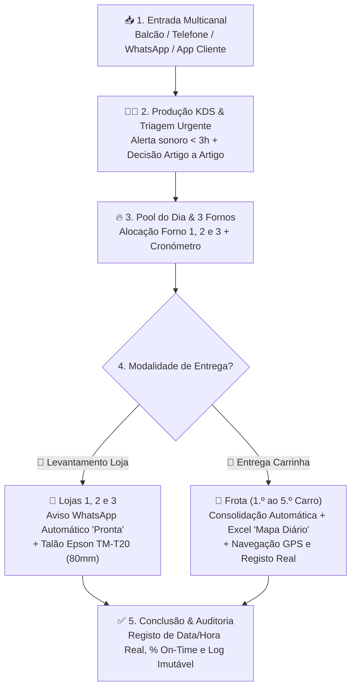
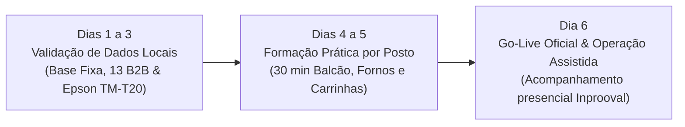
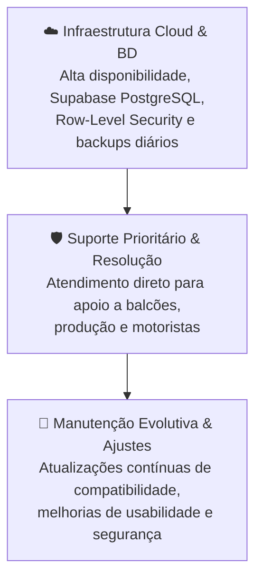

# 💼 Proposta Comercial Executiva — Inteligência Operacional da Produção, Encomendas e Distribuição

**Entidade Prestadora:** EyeQ Lda  
**Marca Comercial:** Inprooval® — *Processos Inteligentes, Resultados Reais.*  
**Destinatário:** À atenção da Gerência — *Padaria da Vila (União Panificadora Central Arouquense, Lda)*  
**Âmbito Base:** Rede de 3 Lojas Físicas + Centro de Produção (3 Fornos) + Frota de 5 Carrinhas (Particulares & 13 Clientes Empresariais B2B) + Cockpit de Gestão  
**Módulo Extra (Add-On Opcional):** App de Pedidos Diretos pelos Clientes (`/encomendar`)  
**Data:** 16 de Outubro de 2026 | **Versão:** 4.1 (`v2.2.0`)  

---

## ÍNDICE DA PROPOSTA

* **01 — Visão do Projeto:** Do movimento físico à decisão informada
* **02 — Manifesto:** O propósito da solução Inprooval®
* **03 — Fluxo Completo da Operação:** Do pedido em papel à expedição e entrega pontual
* **04 — Módulos Operacionais:** 3 Lojas, Produção (3 Fornos), 5 Carrinhas e Gestão
* **05 — Dashboard, Indicadores (KPIs) e Métricas On-Time**
* **06 — Da Análise à Antecipação:** Demonstração de Impacto (*As-Is*) e Roadmap de Inovação
* **07 — Arquitetura Tecnológica, Segurança e Resiliência Local**
* **08 — Roadmap de Implementação e Go-Live Imediato**
* **09 — Investimento:** Budget de Implementação (Solução Base & Módulo Extra)
* **10 — Manutenção, Suporte Técnico e Continuidade Operacional**
* **11 — Gestão do Projeto e Condições Comerciais**

---

## 01 / VISÃO DO PROJETO

### Tornar a operação visível, fluida e mensurável.

A **Padaria da Vila (*União Panificadora Central Arouquense, Lda*)** gere diariamente uma operação complexa e exigente em Arouca que articula **3 lojas físicas**, um **centro de produção próprio com 3 fornos** e uma **frota de 5 carrinhas de distribuição** (4 dedicadas a rotas de clientes particulares e a 5.ª carrinha dedicada a 13 clientes empresariais e institucionais).

A plataforma desenvolvida pela **Inprooval®** cria uma infraestrutura digital comum desenhada à medida da operação de Arouca, sustentada em três pilares estratégicos:

1. **Observar:** Captar os momentos-chave da operação em tempo real, relacionando cada encomenda com o respetivo canal de origem, loja de levantamento ou carrinha de entrega.
2. **Medir:** Construir um histórico consistente de fabrico, ocupação de fornos, cumprimento de quantidades e pontualidade na entrega ao domicílio e ao balcão.
3. **Otimizar & Escalar:** Eliminar o trabalho manual de compilação em papel e Excel, proteger a margem do negócio e assegurar que a gerência tem controlo absoluto sobre o que é encomendado, produzido e entregue.

> [!NOTE]
> **Implementar. Validar. Escalar.**  
> A solução operacional foi integralmente construída e validada para a realidade da Padaria da Vila, encontrando-se pronta para entrada imediata em exploração. Módulos adicionais (como o canal direto do cliente final ou faturação certificada) integram-se de forma natural sobre a mesma base.

---

## 02 / MANIFESTO

> ### *"O objetivo não é apenas digitalizar a padaria.*
> ### *É criar uma camada de inteligência e controlo sobre a operação física, capaz de observar, medir, eliminar falhas e libertar tempo valioso das equipas para o que realmente cria valor."*
> 
> **Inprooval® — EyeQ Lda**

---

## 03 / FLUXO COMPLETO DA OPERAÇÃO

### Da receção do pedido ao fabrico nos fornos e à entrega no cliente.

A operação deixa de depender de notas manuscritas e somas manuais dispersas. Cada pedido segue um fluxo unificado e transparente:

1. **Entrada do Pedido:** Registo rápido ao balcão, por chamada ou WhatsApp com seleção de cliente e artigos (ou submissão direta pelo cliente na App).
2. **Triagem na Fábrica:** Se o pedido tem entrega em $\le 3\text{ horas}$, dispara um alerta sonoro e visual imediato no Centro de Produção, permitindo aceitar ou recusar artigo a artigo (`✓ Produzir` / `✕ Não Produzir`) com feedback instantâneo ao cliente.
3. **Fabrico & Fornos:** Os artigos aceites entram na *Pool Consolidada do Dia* e são alocados aos **3 Fornos**, com cronómetro de cozedura e histórico de fornadas.
4. **Expedição em Loja:** Ao ficar pronta na loja, o sistema **abre automaticamente o WhatsApp** para o cliente a avisar do levantamento e imprime o talão térmico calibrado para a **Epson TM-T20 (80mm)**.
5. **Distribuição em Carrinha:** As 5 carrinhas recebem as suas cargas consolidadas, exportam o ficheiro Excel oficial **«MAPA DIÁRIO»** com 1 clique e registam a hora real de entrega no destino.

---

## 04 / MÓDULOS OPERACIONAIS DA SOLUÇÃO BASE

A solução estrutura-se em **4 postos de trabalho dedicados**, isolados no login por perfil de utilizador:

### 04.1. Balcão Digital Multicanal & Levantamento em Loja (`/encomendas` e `/loja`)
* **Registo em Menos de 30 Segundos:** Seleção ou criação imediata de cliente, identificação do canal (`Presencial`, `Telefone`, `WhatsApp`) e catálogo tátil de artigos.
* **Edição Livre Pós-Registo:** Possibilidade de adicionar novos artigos, alterar quantidades ou eliminar linhas numa encomenda já registada.
* **Impressão Térmica Epson M249A TM-T20 (80mm):** Impressão direta sem cortes nem páginas em branco, com discriminação de artigos, notas de personalização e destaque visual de artigos recusados na produção (`[NÃO PROD.]`).
* **Notificação Automática de Levantamento:** O botão **«✅ Dar Encomenda como Pronta p/ Entrega»** abre automaticamente o WhatsApp com mensagem formatada para o cliente.

### 04.2. Centro de Produção KDS & Gestão dos 3 Fornos (`/producao`)
* **Alerta Urgente Sonoro e Visual ($\le 3\text{ Horas}$):** Ecrã sonoro que obriga à validação da equipa de fabrico, exibindo o canal, a loja de destino e a lista de artigos.
* **Triagem Parcelar Artigo a Artigo:** O padeiro aceita ou recusa cada artigo individualmente (`✓ Produzir` / `✕ Não Produzir`), excluindo do forno o que não pode ser confecionado e adicionando observações para o cliente.
* **Pool Consolidada do Dia & 3 Cartões de Forno (`Forno 1`, `Forno 2`, `Forno 3`):** Consolidação de todas as encomendas aceites com a Base Fixa das Carrinhas 1 a 4 e os Clientes B2B da Carrinha 5, com cronómetro ao vivo por forno.

### 04.3. Logística das 5 Carrinhas & Exportação do «Mapa Diário» (`/entregas`)
* **`1.º Carro` ao `4.º Carro` (Particulares):** Gestão das rotas de distribuição porta-a-porta, somando a Base Fixa Diária às encomendas adicionais agendadas para o dia.
* **`5.º Carro` (13 Clientes Empresariais B2B):** Rota exclusiva para as 13 entidades de Arouca (*Gamarão, Patronato, P.-Telhe, Lar 3.ª Idade, Hospital, Centro D. Urrô, Lar Infância e Juventude, Centro Social Burgo, Cavadinha, Merc. Ribeiro, Café Praça, Padaria da Vila, Empregados*), com matriz de quantidades fixas por dia da semana (`Seg` a `Dom`).
* **Exportação com 1 Clique do Excel Oficial «MAPA DIÁRIO»:** Descarrega o ficheiro `.xlsx` exatamente no formato físico da *União Panificadora Central Arouquense, Lda*, somando as 5 carrinhas, os 13 clientes empresariais e as 29 colunas oficiais de produtos.

### 04.4. Cockpit Executivo de Gestão, Parametrização & Auditoria (`/gestao`)
* **Gestão da Base Fixa Diária (1.º ao 4.º Carro):** Edição inline de nomes de produtos, correção de gralhas com migração automática de quantidades, eliminação de artigos e **Extração / Importação Excel (`.xlsx`)** da grelha completa.
* **Matriz Semanal B2B (5.º Carro):** Parametrização por dia da semana com replicação semanal e importação/exportação Excel.
* **Governação & Auditoria:** Rastreabilidade total de todas as ações dos colaboradores (criação, edição, fornadas, entregas) e controlo de acessos por função (RBAC).

---

## 05 / DASHBOARD, INDICADORES (KPIS) E MÉTRICAS ON-TIME

### Cada movimento passa a ser um dado.

O Cockpit de Gestão calcula automaticamente indicadores vitais da operação, reativos por período (`Hoje`, `Semana`, `Mês`, `Ano`), por Loja e por Formato de Entrega:

| Indicador | O que Mede | Utilidade Operacional para a Gerência |
| :--- | :--- | :--- |
| **Volume de Encomendas ($N_{\text{total}}$)** | Total de pedidos no período filtrado | Dimensionar equipas e planear compras de matéria-prima. |
| **Taxa de Conclusão (\% Concluídas)** | \% de encomendas com entrega concluída | Monitorizar a taxa de escoamento e identificar estrangulamentos. |
| **Volume de Unidades ($Q_{\text{total}}$)** | Soma total de artigos produzidos e expedidos | Acompanhar a capacidade instalada da fábrica. |
| **Taxa de Pontualidade (\% On-Time SLA)** | \% de entregas no horário (tolerância $\le 10$ min) | Garantir o cumprimento de prazos prometidos aos clientes. |
| **Distribuição por Canal** | Quota de Balcão, Telefone, WhatsApp e Online | Identificar a transição digital e os canais de maior volume. |
| **Rankings Top 5** | Artigos mais vendidos em Padaria e Pastelaria | Otimizar a ocupação dos 3 fornos para os artigos com maior procura. |

---

## 06 / DA ANÁLISE À ANTECIPAÇÃO (PROCESSO AS-IS VS. TO-BE)

### 06.1. Demonstração de Impacto: O Processo Atual (*As-Is*)

Atualmente, a compilação e consolidação das quantidades de cada artigo por carrinha é feita todos os dias por um colaborador que recolhe todos os pedidos manuais em papel e cria a tabela em Excel abaixo:

### 06.2. Contabilização Exata de Horas Anuais Libertadas

Com a digitalização e consolidação automática em tempo real na plataforma **Inprooval®**, a recolha manual e soma diária em Excel deixam de existir:

| Indicador Operacional | Valor Medido |
| :--- | :---: |
| **Tempo diário despendido atualmente pelo funcionário no Mapa Diário manual (*As-Is*)** | **$45\text{ minutos / dia}$** |
| **Dias de operação por ano** | **$363\text{ dias / ano}$** |
| **Total de minutos anuais dedicados ao processo manual** | $16.335\text{ minutos / ano}$ |
| **Horas Libertadas por Mês (média)** | **$\approx 22,7\text{ horas / mês}$** |
| **TOTAL DE HORAS ANUAIS LIBERTADAS** | **🎯 $272,25\text{ horas / ano}$** *(272h 15min)* |

$$\text{Horas Libertadas / Ano} = \frac{45\text{ min/dia} \times 363\text{ dias/ano}}{60\text{ min/hora}} = \mathbf{272,25\text{ horas / ano}}$$

### 06.3. Roadmap de Evolução Futura (Fase 2 e Fase 3)
A plataforma foi arquitetada de forma modular para permitir a ativação progressiva de novos módulos de valor:
1. **Integração com Software de Faturação Certificado AT (Fase 2):** Emissão automática de Fatura-Recibo e Guias de Transporte da frota via API (Moloni / InvoiceXpress / PHC).
2. **WhatsApp Business API 100% Silencioso (Fase 2):** Disparo de mensagens diretamente pelo servidor em background, sem necessidade de clique na janela do WhatsApp.
3. **Motor de Explosão de Receitas & Fichas Técnicas (MRP) (Fase 3):** Conversão automática dos totais do Mapa Diário em quilos de farinha, água, fermento e sal para a amassadeira.

---

## 07 / ARQUITETURA TECNOLÓGICA, SEGURANÇA E RESILIÊNCIA

### Uma base sólida, segura e desenhada para o terreno.

* **Frontend & Lógica de Negócio:** Next.js 14 (App Router) + React 18 + TypeScript em modo estrito, com interface tátil responsiva (*Mobile-First* e *Touch-First*).
* **Nuvem & Base de Dados Relacional:** Supabase (PostgreSQL Cloud) com **Row-Level Security (RLS)** ativo e políticas de integridade de dados (`0 erros e 0 avisos de segurança`).
* **Resiliência Offline para Zonas Rurais:** *Cache* local em `localStorage` que assegura a consulta de pedidos e rotas pelas 5 carrinhas mesmo em freguesias de Arouca sem rede móvel (`⚡ Offline Cache`).
* **Impressão Térmica POS:** Motor CSS Paged Media calibrado especificamente para a **Epson M249A TM-T20** (bobina 80mm / 72mm úteis de impressão).
* **Gestão de Conteúdos Git-Backed:** Studio CMS Nativo (`/cms`) integrado diretamente na solução, sem dependências externas pesadas.

---

## 08 / ROADMAP DE IMPLEMENTAÇÃO E GO-LIVE IMEDIATO

Dado que a **Inprooval®** já desenvolveu, calibrou e certificou a solução completa (`v2.2.0`), o prazo de entrada em operação real é **imediato (6 dias úteis)**:

* **Fase 1 (Dias 1 a 3) — Parametrização Final de Dados & Impressão:** Confirmação das quantidades da Base Fixa (1.º ao 4.º Carro), validação da Matriz dos 13 Clientes B2B (5.º Carro) e ensaio físico de impressão nas lojas.
* **Fase 2 (Dias 4 a 5) — Formação Prática por Posto de Trabalho:** Sessões práticas rápidas e intuitivas com os operadores de balcão, padeiros junto aos fornos e motoristas das carrinhas.
* **Fase 3 (Dia 6) — Go-Live Oficial & Operação Assistida:** Entrada em funcionamento produtivo em toda a rede com presença direta da Inprooval® para apoio à equipa.

---

## 09 / INVESTIMENTO (BUDGET DE IMPLEMENTAÇÃO)

Valores apresentados em euros (€), acrescidos de IVA à taxa legal em vigor.

### 09.1. Solução Operacional Base (3 Lojas + 3 Fornos + 5 Carrinhas + Gestão)

| Componente da Solução Base | Âmbito e Entregáveis Incluídos | Investimento (s/ IVA) | Condições de Pagamento |
| :--- | :--- | :---: | :---: |
| **1. Setup, Personalização & Implementação Base** | • Plataforma completa configurada com os 22 requisitos de Arouca + triagem parcelar por artigo e alertas urgentes. • Parametrização das **3 Lojas**, **Centro de Produção (3 Fornos)**, **5 Carrinhas (`1.º` ao `5.º Carro`)**, **Base Fixa de Particulares** (com edição e Excel) e **13 Clientes Empresariais B2B**. • Calibração de impressão térmica na **Epson M249A TM-T20 (80mm)**. • Formação prática presencial à equipa e acompanhamento no Go-Live. | **2.500,00 €** | **50% na Adjudicação** (`1.250,00 €`) **50% no Go-Live** (`1.250,00 €`) |
| **2. Manutenção Mensal, Cloud, Suporte & Continuidade** | • Alojamento Cloud de alta disponibilidade e Base de Dados sincronizada em tempo real com RLS ativo. • Backups diários automáticos e histórico de auditoria. • Suporte técnico prioritário, manutenção evolutiva e assistência técnica contínua. | **250,00 € / mês** | Mensal (após Go-Live) |

### 09.2. Módulo Extra Opcional (Add-On) — App de Pedidos Diretos pelo Cliente (`/encomendar`)

| Módulo Extra (Add-On) | Funcionalidades Exclusivas para o Cliente Final | Investimento Extra (s/ IVA) |
| :--- | :--- | :---: |
| **EXTRA: App de Pedidos Diretos pelos Clientes (`/encomendar`)** | • **Jornada e Login Exclusivo para Clientes:** Acesso seguro com Password definida pelo cliente e Recuperação de Password por E-mail via **Supabase Auth**. • **Catálogo Exclusivo de Quantidades (Sem Preços):** O cliente seleciona artigos e quantidades sem exposição de tabelas de preços. • **Acompanhamento em Tempo Real com Estado Parcelar:** O cliente acompanha os 4 estados do pedido, vê que artigos foram aceites ou recusados pela fábrica e lê as observações da padaria. • **Integração Automática na Fábrica e Carrinhas:** Os pedidos online entram diretamente no alerta urgente da produção e no cálculo de cargas das carrinhas. | **+ 650,00 € (Setup Único)** **+ 50,00 € / mês** |

---

## 10 / MANUTENÇÃO, SUPORTE TÉCNICO E CONTINUIDADE OPERACIONAL

### Continuidade garantida para uma operação sem paragens.

A avença mensal assegura que a infraestrutura da Padaria da Vila funciona 363 dias por ano com estabilidade absoluta:

* **Infraestrutura Cloud & Base de Dados em Tempo Real:** Servidores de aplicação e base de dados relacional com monitorização de saúde 24/7.
* **Salvaguarda de Dados & Backups:** Cópias de segurança diárias automáticas com capacidade de restauro imediato.
* **Apoio Técnico Prioritário:** Canal direto de suporte com a equipa técnica da Inprooval® para esclarecimento de dúvidas e resolução rápida de eventuais incidências.
* **Manutenção Contínua:** Atualizações de sistema, patches de segurança e afinações operacionais incluídas.

---

## 11 / GESTÃO DO PROJETO E CONDIÇÕES COMERCIAIS

### 11.1. Metodologia de Gestão do Projeto

1. **Planear & Parametrizar em Conjunto:** Confirmação com a gerência das quantidades da Base Fixa e rotas das 5 carrinhas.
2. **Entregar & Testar no Terreno:** Ensaios físicos de impressão térmica nas lojas e verificação das rotas de entrega.
3. **Validar & Arrancar:** Sessão prática com os colaboradores e arranque assistido no terreno no dia de Go-Live.

### 11.2. Condições Comerciais Gerais

1. **Investimento e Impostos:** Todos os valores apresentados são em euros (€) e não incluem IVA, sendo este adicionado à taxa legal em vigor.
2. **Equipamento de Balcão (Hardware):** A impressora térmica de talões (**Epson M249A TM-T20**), computadores de balcão e smartphones das carrinhas são fornecidos/detidos pela Padaria da Vila, estando incluída na proposta toda a calibração de software e testes de impressão.
3. **Condições de Pagamento:**
   * **Implementação Base:** 50% no ato da adjudicação da proposta (`1.250,00 € + IVA`) e 50% na data de Go-Live oficial (`1.250,00 € + IVA`).
   * **Manutenção Mensal:** Faturada mensalmente a partir do início da exploração operacional em produção.
4. **Prazo de Entrega:** Entrada em exploração em 6 dias úteis após adjudicação formal e disponibilização dos postos de trabalho para parametrização.
5. **Âmbito e Trabalhos Adicionais:** Quaisquer desenvolvimentos futuros que não constem do âmbito base descrito nesta proposta (tais como integrações de software de faturação certificado ou novos módulos à medida) serão previamente orçamentados com base na taxa horária de referência de **80,00 €/hora + IVA**.

---

**EyeQ Lda / Inprooval®**  
*Processos Inteligentes, Resultados Reais.*  
NIF: `515075337` • E-mail: `contacto@inprooval.pt`
