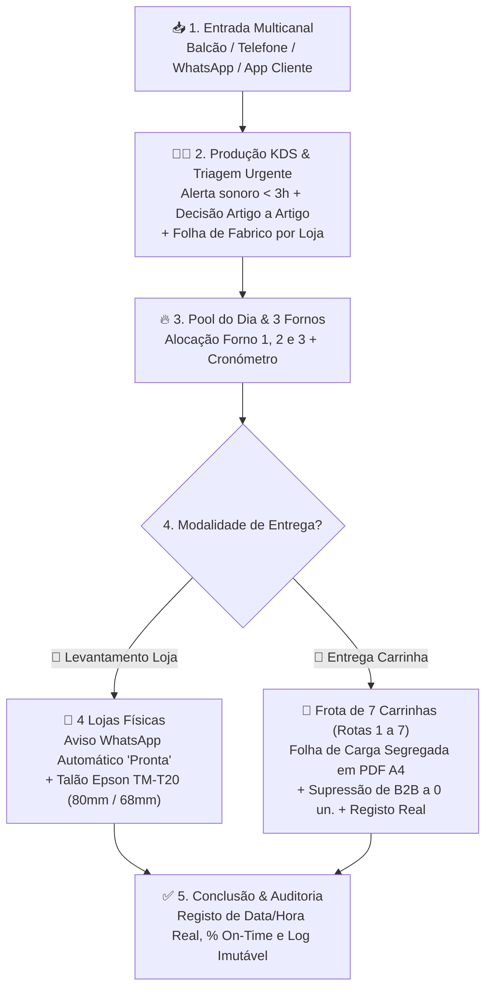
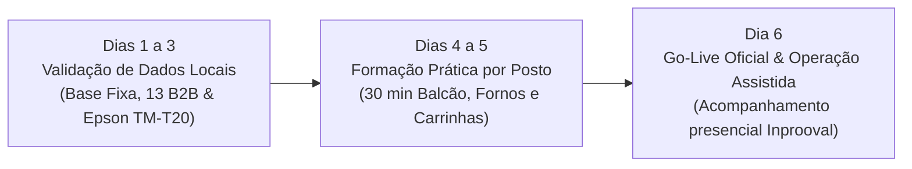
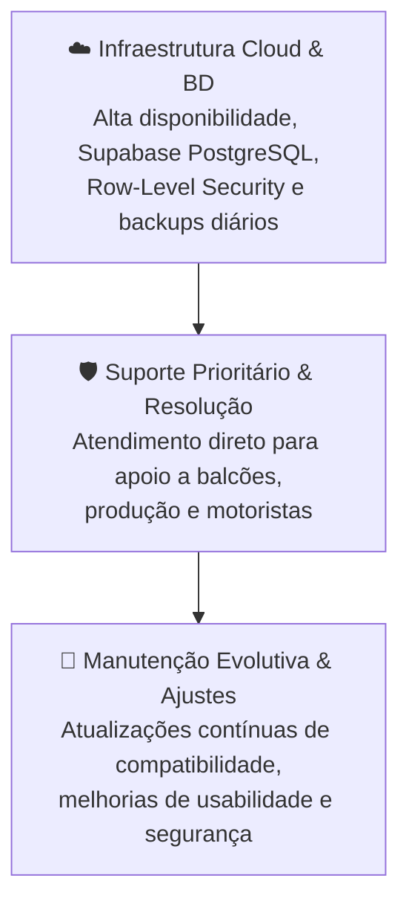

# 💼 Proposta Comercial Executiva — Inteligência Operacional da Produção, Encomendas e Distribuição

**Entidade Prestadora:** EyeQ Lda  
**Marca Comercial:** Inprooval® — *Processos Inteligentes, Resultados Reais.*  
**Destinatário:** À atenção da Gerência — *Padaria da Vila (União Panificadora Central Arouquense, Lda)*  
**Âmbito Global:** Rede de 4 Lojas Físicas + Centro de Produção (3 Fornos) + Frota de 7 Carrinhas / Rotas (Particulares & 21 Clientes Empresariais B2B) + Portal do Cliente (`/encomendar`) + Cockpit de Gestão  
**Subdomínio Oficial:** `app.padariadavila.com`  
**Data:** 24 de Outubro de 2026 | **Versão:** 5.1 (`v2.7.19`)  

---

## ÍNDICE DA PROPOSTA

* **01 — Visão do Projeto:** Do movimento físico à decisão informada
* **02 — Manifesto:** O propósito da solução Inprooval®
* **03 — Fluxo Completo da Operação:** Do pedido em papel à expedição e entrega pontual
* **04 — Módulos Operacionais:** 4 Lojas, Produção (3 Fornos), 7 Carrinhas, 21 B2B e Gestão
* **05 — Dashboard, Indicadores (KPIs) e Métricas On-Time**
* **06 — Da Análise à Antecipação:** Demonstração de Impacto (*As-Is*) e Roadmap de Inovação
* **07 — Arquitetura Tecnológica, Segurança e Resiliência Local**
* **08 — Roadmap de Implementação e Go-Live Imediato**
* **09 — Investimento:** Budget de Implementação (Solução Base & Módulo Extra)
* **10 — Manutenção, Suporte Técnico e Continuidade Operacional**
* **11 — Gestão do Projeto e Condições Comerciais**

---

## 01 / VISÃO DO PROJETO

### Tornar a operação visível, fluida e mensurável.

A **Padaria da Vila (*União Panificadora Central Arouquense, Lda*)** gere diariamente uma operação complexa e exigente em Arouca que articula **4 lojas físicas** (*Matriz/Fábrica, Praça, Mercado, Centro*), um **centro de produção próprio com 3 fornos** e uma **frota de 7 carrinhas de distribuição** (Rotas 1 a 7 dedicadas a abastecimento, clientes particulares e 21 clientes empresariais e institucionais).

A plataforma desenvolvida pela **Inprooval®** cria uma infraestrutura digital comum desenhada à medida da operação de Arouca, sustentada em três pilares estratégicos:

1. **Observar:** Captar os momentos-chave da operação em tempo real, relacionando cada encomenda com o respetivo canal de origem, loja de levantamento ou carrinha de entrega.
2. **Medir:** Construir um histórico consistente de fabrico, ocupação de fornos, cumprimento de quantidades e pontualidade na entrega ao domicílio e ao balcão.
3. **Otimizar & Escalar:** Eliminar o trabalho manual de compilação em papel e Excel, proteger a margem do negócio e assegurar que a gerência tem controlo absoluto sobre o que é encomendado, produzido e entregue.

> [!NOTE]
> **Implementar. Validar. Escalar.**  
> A solução operacional foi integralmente construída e validada para a realidade da Padaria da Vila, encontrando-se pronta para entrada imediata em exploração. O portal do cliente final (`/encomendar`) e a gestão inteligente de entregas recorrentes com Modo Férias já se encontram totalmente integrados.

---

## 02 / MANIFESTO

> ### *"O objetivo não é apenas digitalizar a padaria.*
> ### *É criar uma camada de inteligência e controlo sobre a operação física, capaz de observar, medir, eliminar falhas e libertar tempo valioso das equipas para o que realmente cria valor."*
> 
> **Inprooval® — EyeQ Lda**

---

## 03 / FLUXO COMPLETO DA OPERAÇÃO

### Da receção do pedido ao fabrico nos fornos e à entrega no cliente.

A operação deixa de depender de notas manuscritas e somas manuais dispersas. Cada pedido segue um fluxo unificado e transparente:

1. **Entrada do Pedido:** Registo rápido ao balcão, por chamada ou WhatsApp com seleção de cliente e artigos (ou submissão direta pelo cliente no portal `/encomendar`).
2. **Triagem na Fábrica:** Se o pedido tem entrega em $\le 3\text{ horas}$, dispara um alerta sonoro e visual imediato no Centro de Produção, permitindo aceitar ou recusar artigo a artigo (`✓ Produzir` / `✕ Não Produzir`) com feedback instantâneo ao cliente. Emissão da **Folha de Fabrico de Encomendas discriminada por loja** com quebras de página limpas e vistos de embalamento.
3. **Fabrico & Fornos:** Os artigos aceites entram na *Pool Consolidada do Dia* e são alocados aos **3 Fornos**, com cronómetro de cozedura e histórico de fornadas.
4. **Expedição em Loja:** Ao ficar pronta na loja, o sistema **abre automaticamente o WhatsApp** para o cliente a avisar do levantamento e imprime o talão térmico calibrado para a **Epson TM-T20 (80mm com 68mm úteis)**.
5. **Distribuição em Carrinha:** As 7 carrinhas recebem a sua **Folha de Carga Oficial em PDF A4**, segregada em 4 níveis estanques (Base Diária, 21 Clientes B2B sem 0 un., Encomendas ao Domicílio e Resumo Consolidado com caixas estimadas), e registam a hora real de entrega.

---

## 04 / MÓDULOS OPERACIONAIS DA SOLUÇÃO GLOBAL

A solução estrutura-se em **4 postos de trabalho dedicados**, isolados no login por perfil de utilizador:

### 04.1. Balcão Digital Multicanal & Levantamento em Loja (`/encomendas` e `/loja`)
* **Rede de 4 Lojas Físicas:** *Padaria da Vila (Matriz / Fábrica)*, *Padaria da Praça*, *Padaria do Liceu / Mercado* e *Padaria Centro*.
* **Registo em Menos de 30 Segundos:** Seleção ou criação imediata de cliente, identificação do canal (`Presencial`, `Telefone`, `WhatsApp`) e catálogo tátil de artigos.
* **Edição Livre Pós-Registo:** Possibilidade de adicionar novos artigos, alterar quantidades ou eliminar linhas numa encomenda já registada.
* **Impressão Térmica Epson M249A TM-T20 (80mm / 68mm úteis):** Impressão direta sem cortes nem páginas em branco, com discriminação de artigos, notas de personalização, destaque visual de artigos recusados (`[NÃO PROD.]`) e QR Code de conferência.
* **Notificação Automática de Levantamento:** O botão **«✅ Dar Encomenda como Pronta p/ Entrega»** abre automaticamente o WhatsApp com mensagem formatada para o cliente.

### 04.2. Centro de Produção KDS & Gestão dos 3 Fornos (`/producao`)
* **Alerta Urgente Sonoro e Visual ($\le 3\text{ Horas}$):** Ecrã com alerta sonoro contínuo que obriga à validação da equipa de fabrico, exibindo o canal, a loja de destino e a lista de artigos.
* **Triagem Parcelar Artigo a Artigo & Botão Incondicional de Conclusão:** O padeiro aceita ou recusa cada artigo individualmente (`✓ Produzir` / `✕ Não Produzir`) e dispõe do botão de conclusão de produção direto nos cartões KDS sem barreiras de permissão.
* **Folha de Fabrico de Encomendas Discriminada por Loja:** Ao filtrar por Encomendas na Pool de Produção, o sistema gera a Folha de Fabrico dividida loja a loja, com detalhe pedido a pedido, contactos, horário agendado, notas e visto de conferência.
* **Pool Consolidada do Dia & 3 Cartões de Forno (`Forno 1`, `Forno 2`, `Forno 3`):** Consolidação de todas as encomendas aceites com a Base Semanal das 7 Carrinhas e os 21 Clientes B2B, com cronómetro ao vivo por forno.

### 04.3. Logística das 7 Carrinhas & Folhas de Carga Segregadas (`/entregas`)
* **Frota de 7 Carrinhas (`Rota 1` a `Rota 7`):** Cobertura geográfica de todo o concelho de Arouca para abastecimento, entregas particulares e fornecimento institucional.
* **Folha de Carga Oficial em PDF A4 com Segregação Estrita em 4 Níveis:**
  1. *Base Diária / Abastecimento:* Quantidades carregadas na viatura para porta-a-porta e venda livre (com subtotal próprio).
  2. *Desdobramento B2B:* Quantidades dos 21 clientes empresariais, **suprimindo entidades a 0 unidades** (ex: escolas e associações fechadas ao fim de semana).
  3. *Encomendas Adicionais ao Domicílio:* Lista discriminada por cliente, morada, telefone e artigos adicionais do dia.
  4. *Resumo Geral Consolidado:* Caixa final com a soma rigorosa de todas as secções e cálculo automático de caixas estimadas.
* **Modo Férias em Tempo Real:** Suspensão imediata de entregas a clientes institucionais em pausa letiva ou férias, sem distorcer o fabrico nem a carga.

### 04.4. Cockpit Executivo de Gestão, Parametrização & Auditoria (`/gestao`)
* **Base Semanal Configurável (`quantidades_semanais` 7 dias):** Parametrização dia a dia (`seg` a `dom`) de abastecimentos por carrinha e de contratos B2B.
* **Normalização Canónica de Artigos (57 Produtos Canónicos):** Reconciliação automática de sinónimos (*Pão Saloio*, *Broas Amarelas*) e renomeação em cascata com migração de histórico.
* **Governação & Auditoria:** Rastreabilidade total de todas as ações dos colaboradores (criação, edição, fornadas, entregas) e controlo de acessos por função (RBAC).

---

## 05 / DASHBOARD, INDICADORES (KPIS) E MÉTRICAS ON-TIME

### Cada movimento passa a ser um dado.

O Cockpit de Gestão calcula automaticamente indicadores vitais da operação, reativos por período (`Hoje`, `Semana`, `Mês`, `Ano`), por Loja e por Formato de Entrega:

| Indicador | O que Mede | Utilidade Operacional para a Gerência |
| :--- | :--- | :--- |
| **Volume de Encomendas ($N_{\text{total}}$)** | Total de pedidos no período filtrado | Dimensionar equipas e planear compras de matéria-prima. |
| **Taxa de Conclusão (\% Concluídas)** | \% de encomendas com entrega concluída | Monitorizar a taxa de escoamento e identificar estrangulamentos. |
| **Volume de Unidades ($Q_{\text{total}}$)** | Soma total de artigos produzidos e expedidos | Acompanhar a capacidade instalada da fábrica. |
| **Taxa de Pontualidade (\% On-Time SLA)** | \% de entregas no horário (tolerância $\le 10$ min) | Garantir o cumprimento de prazos prometidos aos clientes. |
| **Distribuição por Canal** | Quota de Balcão, Telefone, WhatsApp e Online | Identificar a transição digital e os canais de maior volume. |
| **Rankings Top 5** | Artigos mais vendidos em Padaria e Pastelaria | Otimizar a ocupação dos 3 fornos para os artigos com maior procura. |

---

## 06 / DA ANÁLISE À ANTECIPAÇÃO (PROCESSO AS-IS VS. TO-BE)

### 06.1. Demonstração de Impacto: O Processo Atual (*As-Is*)

Atualmente, a compilação e consolidação das quantidades de cada artigo por carrinha é feita todos os dias por um colaborador que recolhe todos os pedidos manuais em papel e cria a tabela em Excel abaixo:

### 06.2. Contabilização Exata de Horas Anuais Libertadas

Com a digitalização e consolidação automática em tempo real na plataforma **Inprooval®**, a recolha manual e soma diária em Excel deixam de existir:

| Indicador Operacional | Valor Medido |
| :--- | :---: |
| **Tempo diário despendido atualmente pelo funcionário no Mapa Diário manual (*As-Is*)** | **$45\text{ minutos / dia}$** |
| **Dias de operação por ano** | **$363\text{ dias / ano}$** |
| **Total de minutos anuais dedicados ao processo manual** | $16.335\text{ minutos / ano}$ |
| **Horas Libertadas por Mês (média)** | **$\approx 22,7\text{ horas / mês}$** |
| **TOTAL DE HORAS ANUAIS LIBERTADAS** | **🎯 $272,25\text{ horas / ano}$** *(272h 15min)* |

$$\text{Horas Libertadas / Ano} = \frac{45\text{ min/dia} \times 363\text{ dias/ano}}{60\text{ min/hora}} = \mathbf{272,25\text{ horas / ano}}$$

### 06.3. Roadmap de Evolução Futura (Fase 2 e Fase 3)
A plataforma foi arquitetada de forma modular para permitir a ativação progressiva de novos módulos de valor:
1. **Integração com Software de Faturação Certificado AT (Fase 2):** Emissão automática de Fatura-Recibo e Guias de Transporte da frota via API (Moloni / InvoiceXpress / PHC).
2. **WhatsApp Business API 100% Silencioso (Fase 2):** Disparo de mensagens diretamente pelo servidor em background, sem necessidade de clique na janela do WhatsApp.
3. **Motor de Explosão de Receitas & Fichas Técnicas (MRP) (Fase 3):** Conversão automática dos totais do Mapa Diário em quilos de farinha, água, fermento e sal para a amassadeira.

---

## 07 / ARQUITETURA TECNOLÓGICA, SEGURANÇA E RESILIÊNCIA

### Uma base sólida, segura e desenhada para o terreno.

* **Frontend & Lógica de Negócio:** Next.js 14 (App Router) + React 18 + TypeScript em modo estrito, com interface tátil responsiva (*Mobile-First* e *Touch-First*).
* **Nuvem & Base de Dados Relacional:** Supabase (PostgreSQL Cloud) com **Row-Level Security (RLS)** ativo e políticas de integridade de dados (`0 erros e 0 avisos de segurança`).
* **Resiliência Offline para Zonas Rurais:** *Cache* local em `localStorage` que assegura a consulta de pedidos e rotas pelas 7 carrinhas mesmo em freguesias de Arouca sem rede móvel (`⚡ Offline Cache`).
* **Impressão Térmica POS:** Motor CSS Paged Media calibrado especificamente para a **Epson M249A TM-T20** (bobina 80mm com 68mm úteis de impressão calibrada).
* **Gestão de Conteúdos Git-Backed:** Studio CMS Nativo (`/cms`) integrado diretamente na solução, sem dependências externas pesadas.
* **Salvaguarda de Continuidade de Negócio (BCP / Modo Degradado):** Motor de contingência automático que gera e envia todas as noites às 00h15 os cadernos oficiais em PDF de Fabrico (4 Lojas) e Carga (7 Carrinhas) via Resend API, assegurando operação 100% autoral e sem falhas mesmo em caso de apagão total de internet ou cloud.

---

## 08 / ROADMAP DE IMPLEMENTAÇÃO E GO-LIVE IMEDIATO

Dado que a **Inprooval®** já desenvolveu, calibrou e certificou a solução completa (`v2.2.0`), o prazo de entrada em operação real é **imediato (6 dias úteis)**:

* **Fase 1 (Dias 1 a 3) — Parametrização Final de Dados & Impressão:** Confirmação das quantidades da Base Fixa (1.º ao 4.º Carro), validação da Matriz dos 13 Clientes B2B (5.º Carro) e ensaio físico de impressão nas lojas.
* **Fase 2 (Dias 4 a 5) — Formação Prática por Posto de Trabalho:** Sessões práticas rápidas e intuitivas com os operadores de balcão, padeiros junto aos fornos e motoristas das carrinhas.
* **Fase 3 (Dia 6) — Go-Live Oficial & Operação Assistida:** Entrada em funcionamento produtivo em toda a rede com presença direta da Inprooval® para apoio à equipa.

---

## 09 / INVESTIMENTO (BUDGET DE IMPLEMENTAÇÃO)

Valores apresentados em euros (€), acrescidos de IVA à taxa legal em vigor.

### 09.1. Pacote Global Turn-Key & Bolsa de 110 Horas (4 Lojas + 3 Fornos + 7 Carrinhas + 21 B2B + Portal + Gestão)

| Componente da Solução Global | Âmbito e Entregáveis Incluídos | Investimento (s/ IVA) | Condições de Pagamento |
| :--- | :--- | :---: | :---: |
| **1. Pacote Operacional Turn-Key — Setup, Implementação & Bolsa de Horas** | • **Plafond Global de 110 Horas** de Engenharia, Consultoria de Processos e Suporte ao Arranque (taxa horária bonificada de `50,00 €/h`). • Configuração integral das **4 Lojas Físicas** (*Matriz/Fábrica, Praça, Mercado, Centro*), **Centro de Produção (3 Fornos)** e **Frota de 7 Carrinhas / Rotas (1 a 7)**. • Subdomínio oficial seguro `app.padariadavila.com` com encriptação e isolamento por cockpit de trabalho. • KDS de Produção com Alerta Urgente ($\le 3\text{h}$), triagem parcelar, botão incondicional de conclusão e **Folha de Fabrico de Encomendas discriminada por loja**. • Logística de Distribuição com **Folha de Carga Segregada em PDF A4** (Base Diária, 21 Clientes B2B sem 0 un., Encomendas ao Domicílio e Resumo Consolidado com caixas estimadas). • **Motor de Continuidade de Negócio (BCP / Modo Degradado)** com envio diário automático noturno às 00h15 das Folhas de Fabrico e de Carga em PDF nativo para proteção total contra falhas de internet ou rede. • Base Semanal (`quantidades_semanais` 7 dias), Modo Férias em tempo real e Normalização Canónica de 57 artigos. • **App de Pedidos Diretos pelos Clientes (`/encomendar`)** com login seguro, catálogo sem preços, acompanhamento em tempo real e recuperação de password. • Calibração de impressão térmica POS na **Epson M249A TM-T20 (80mm / 68mm úteis)**. • Formação prática presencial por posto de trabalho e acompanhamento assistido no Go-Live. | **5.500,00 €** | **50% na Adjudicação** (`2.750,00 €`) **50% no Go-Live** (`2.750,00 €`) |
| **2. Manutenção Mensal, Cloud, Suporte & Continuidade** | • Alojamento Cloud de alta disponibilidade e Base de Dados sincronizada em tempo real com RLS ativo. • Backups diários automáticos, monitorização contínua e histórico de auditoria. • Suporte técnico prioritário, manutenção preventiva e evolutiva contínua. | **250,00 € / mês** *(ou 300,00 €/mês com Portal)* | Mensal (após Go-Live) |

---

## 10 / MANUTENÇÃO, SUPORTE TÉCNICO E CONTINUIDADE OPERACIONAL

### Continuidade garantida para uma operação sem paragens.

A avença mensal assegura que a infraestrutura da Padaria da Vila funciona 363 dias por ano com estabilidade absoluta:

* **Infraestrutura Cloud & Base de Dados em Tempo Real:** Servidores de aplicação e base de dados relacional com monitorização de saúde 24/7.
* **Salvaguarda de Dados & Backups:** Cópias de segurança diárias automáticas com capacidade de restauro imediato.
* **Apoio Técnico Prioritário:** Canal direto de suporte com a equipa técnica da Inprooval® para esclarecimento de dúvidas e resolução rápida de eventuais incidências.
* **Manutenção Contínua:** Atualizações de sistema, patches de segurança e afinações operacionais incluídas.

---

## 11 / GESTÃO DO PROJETO E CONDIÇÕES COMERCIAIS

### 11.1. Metodologia de Gestão do Projeto

1. **Planear & Parametrizar em Conjunto:** Confirmação com a gerência das quantidades da Base Semanal, rotas das 7 carrinhas e matriz dos 21 clientes B2B.
2. **Entregar & Testar no Terreno:** Ensaios físicos de impressão térmica nas lojas e verificação das folhas de carga das carrinhas.
3. **Validar & Arrancar:** Sessão prática com os colaboradores e arranque assistido no terreno no dia de Go-Live.

### 11.2. Condições Comerciais Gerais

1. **Investimento e Impostos:** Todos os valores apresentados são em euros (€) e não incluem IVA, sendo este adicionado à taxa legal em vigor.
2. **Equipamento de Balcão (Hardware):** A impressora térmica de talões (**Epson M249A TM-T20**), computadores de balcão e smartphones das carrinhas são fornecidos/detidos pela Padaria da Vila, estando incluída na proposta toda a calibração de software e testes de impressão.
3. **Condições de Pagamento:**
   * **Implementação Global Turn-Key:** 50% no ato da adjudicação da proposta (`2.750,00 € + IVA`) e 50% na data de Go-Live oficial (`2.750,00 € + IVA`).
   * **Manutenção Mensal:** Faturada mensalmente a partir do início da exploração operacional em produção.
4. **Prazo de Entrega:** Entrada em exploração em 6 dias úteis após adjudicação formal e disponibilização dos postos de trabalho para parametrização.
5. **Âmbito e Trabalhos Adicionais:** Quaisquer desenvolvimentos futuros que não constem do âmbito global descrito nesta proposta (tais como integração certificada AT Moloni/InvoiceXpress, WhatsApp Cloud API silencioso ou MRP de amassadura) serão orçamentados com base na taxa de tabela de **150,00 €/hora + IVA**.

---

**EyeQ Lda / Inprooval®**  
*Processos Inteligentes, Resultados Reais.*  
NIF: `515075337` • E-mail: `contacto@inprooval.pt`
