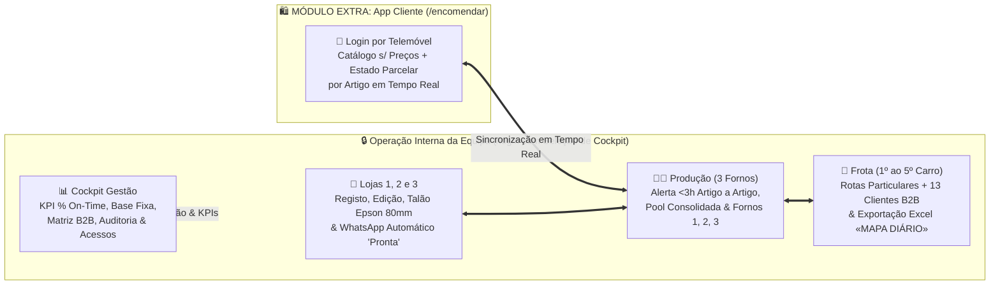

# 💼 Proposta Comercial Executiva — Sistema Integrado de Gestão de Encomendas, Produção (3 Fornos) e Distribuição (5 Carrinhas)

**Entidade Prestadora:** EyeQ Lda  
**Marca Comercial:** Inprooval® — *Processos Inteligentes, Resultados Reais.*  
**Destinatário:** À atenção da Gerência — *Padaria da Vila (União Panificadora Central Arouquense, Lda)*  
**Âmbito Base:** 3 Lojas Físicas + Centro de Produção (3 Fornos) + Frota de 5 Carrinhas (Particulares & Clientes Empresariais B2B) + Cockpit de Gestão  
**Módulo Extra (Add-On):** App de Pedidos Diretos feitos pelos Clientes (`/encomendar`)  
**Data:** 12 de Outubro de 2026 | **Versão:** 3.1  

---

## 1. Sumário Executivo: O Valor que Traduzimos para a Padaria da Vila

A **Padaria da Vila (*União Panificadora Central Arouquense, Lda*)** gere diariamente uma operação exigente que articula **3 lojas físicas**, um **centro de produção próprio com 3 fornos** e uma **frota de 5 carrinhas de distribuição** (4 dedicadas a rotas de clientes particulares e a 5.ª carrinha dedicada a 13 clientes empresariais e institucionais em Arouca).

O trabalho desenvolvido pela **Inprooval®** transforma processos manuais baseados em papel, chamadas telefónicas e somas manuais num **ecossistema digital integrado, simples e à prova de falhas**, desenhado especificamente à medida da realidade de Arouca:

| Antes da Solução Inprooval® (Operação Manual) | Depois da Solução Inprooval® (Operação Digital Integrada) | Impacto Direto no Negócio |
| :--- | :--- | :--- |
| **Pedidos dispersos em papel, telefone e WhatsApp:** Risco de esquecimentos, notas perdidas e dificuldade em alterar artigos depois de o pedido inicial ser anotado. | **Balcão Digital Multicanal (`/encomendas`):** Registo rápido com identificação do canal, edição livre de artigos a qualquer momento e impressão imediata na **Epson M249A TM-T20 (80mm)**. | **Zero pedidos esquecidos** e atendimento ao balcão em menos de 30 segundos. |
| **Encomendas urgentes (< 3h) sem aviso imediato na produção e sem resposta rápida ao cliente quando falta um artigo.** | **Alerta Sonoro/Visual (< 3h) com Decisão Artigo a Artigo (`/producao`):** O padeiro vê o canal, a loja e os artigos do pedido, aceita ou recusa artigo a artigo (`✓ Produzir` / `✕ Não Produzir`), adiciona observações e notifica o cliente na App ou por WhatsApp. | **100% de controlo sobre urgências** e comunicação transparente e profissional com o cliente. |
| **Compilação manual diária da folha do «Mapa Diário» das 5 Carrinhas.** | **Exportação com 1 Clique do Excel Oficial «MAPA DIÁRIO» (`/entregas`):** Soma automaticamente a Base Fixa (1.º ao 4.º Carro), a Matriz Semanal dos 13 Clientes B2B (5.º Carro) e os Pedidos Adicionais do dia nos 29 produtos oficiais. | **Poupança de 45 a 60 minutos todos os dias** (mais de **25 horas/mês** de trabalho administrativo eliminado). |
| **Clientes sem visibilidade de quando a encomenda fica pronta na loja.** | **Notificação Automática por WhatsApp na Loja (`/loja`):** Quando a loja dá a encomenda como pronta para entrega, abre automaticamente o WhatsApp para avisar o cliente que já pode levantar o seu pedido. | **Redução drástica de chamadas** para as lojas e maior satisfação do cliente. |

---

## 2. Arquitetura Funcional da Solução e Jornadas (Equipa vs. Cliente)

### 2.1. Módulos Incluídos na Solução Operacional Base (Equipa Interna)

1. **Login por Cockpit de Trabalho (`/login`):**
   - Cada colaborador seleciona à entrada o seu posto (`Loja 1`, `Loja 2`, `Loja 3`, `Centro de Produção`, `Carrinhas` ou `Gestão`), visualizando apenas os ecrãs e encomendas da sua função.
2. **Balcão Multiloja e Edição Flexível de Encomendas (`/encomendas`):**
   - Registo de pedidos por canal (`Presencial`, `Telefone`, `WhatsApp`), possibilidade de adicionar ou eliminar artigos após o pedido inicial e impressão térmica calibrada para a **Epson M249A TM-T20 (80mm / 72mm úteis)**.
3. **Centro de Produção, Triagem Parcelar de Urgências e 3 Fornos (`/producao`):**
   - **Alerta Sonoro e Visual ($\le 3\text{ Horas}$):** Mostra o canal, a loja/destino e permite aceitar ou recusar **cada artigo individualmente** (`✓ Produzir` / `✕ Não Produzir`), adicionar observações e enviar notificação por WhatsApp ao cliente.
   - **Pool Consolidada do Dia + 3 Cartões de Forno (`Forno 1`, `Forno 2`, `Forno 3`):** Soma todas as encomendas aceites com a Base Fixa das Carrinhas 1 a 4 e os Clientes B2B da Carrinha 5, com cronómetro de cozedura ao vivo.
4. **Balcão de Levantamento em Loja com WhatsApp Automático (`/loja`):**
   - Botão **«✅ Dar Encomenda como Pronta p/ Entrega»** que abre automaticamente o WhatsApp para avisar o cliente, e registo da **Data e Hora Real de Levantamento**.
5. **Logística das 5 Carrinhas e Exportação do «Mapa Diário» (`/entregas`):**
   - Gestão diferenciada do **`1.º` ao `4.º Carro` (Particulares)** e do **`5.º Carro` (13 Clientes Empresariais B2B)**, navegação GPS Google Maps e exportação instantânea do ficheiro Excel **«MAPA DIÁRIO»**.
6. **Cockpit de Gestão e Controlo Executivo (`/gestao`):**
   - Indicadores em tempo real (Volume, Canais, Rankings e **Taxa de Pontualidade `% On-Time`**), configuração da Base Fixa (1.º–4.º Carro), Matriz Semanal B2B (5.º Carro) com importação Excel, Logs de Auditoria e Gestão de Acessos.

---

## 3. Investimento, Parcelas e Cronograma de Entrega

### 3.1. Solução Operacional Base (3 Lojas + 3 Fornos + 5 Carrinhas + Cockpit de Gestão)

| Componente | Descrição e Entregáveis Incluídos | Investimento (s/ IVA) | Condições de Pagamento |
| :--- | :--- | :---: | :---: |
| **1. Setup, Personalização & Implementação Base** | • Plataforma operacional completa já configurada com os 22 requisitos de Arouca + triagem parcelar por artigo e notificações WhatsApp. • Parametrização das 3 Lojas, 3 Fornos, 5 Carrinhas, Base Fixa e 13 Clientes Empresariais B2B. • Calibração de impressão térmica na **Epson M249A TM-T20**. • Sessão de formação prática presencial/online à equipa e apoio no arranque (*Go-Live*). | **2.500,00 €** | **50% na Adjudicação** (`1.250,00 €`) **50% no Go-Live** (`1.250,00 €`) |
| **2. Manutenção Mensal, Cloud & Suporte Técnico** | • Alojamento Cloud de alta disponibilidade e Base de Dados sincronizada em tempo real. • Backups diários automáticos e registo de auditoria. • Suporte técnico prioritário e atualizações contínuas. | **250,00 € / mês** | Mensal (após Go-Live) |

### 3.2. Módulo Extra Opcional (Add-On) — App de Pedidos Diretos pelo Cliente (`/encomendar`)

| Módulo Extra (Add-On) | Benefícios e Funcionalidades Exclusivas | Investimento Extra (s/ IVA) |
| :--- | :--- | :---: |
| **EXTRA: App de Pedidos Diretos pelos Clientes (`/encomendar`)** | • **Jornada e Ecrã de Login Exclusivo para Clientes:** Acesso direto por telemóvel, independente do login da equipa. • **Catálogo Exclusivo de Quantidades (Sem Preços):** O cliente escolhe artigos, quantidades e notas sem exposição de preços. • **Tracking em Tempo Real com Estado Parcelar por Artigo:** No menu *«As Minhas Encomendas»*, o cliente acompanha as 4 etapas da encomenda, vê se cada artigo foi aceite ou recusado pela produção e lê as observações da padaria. | **+ 650,00 € (Setup Único)** **+ 50,00 € / mês** |

---

## 4. Tempo de Desenvolvimento, Implementação e Entrega (Imediato)

Dado que a **Inprooval®** já desenvolveu e validou na íntegra todos os módulos operacionais (encontrando-se a versão `v2.1.0` pronta e funcional), o calendário de entrada em produção é **imediato**:

| Fase de Entrega | Prazo após Adjudicação | Atividades no Terreno / Online |
| :--- | :---: | :--- |
| **Fase 1: Validação Final de Dados & Impressora** | **Dias 1 a 3** | Confirmação das quantidades da Base Fixa (1.º ao 4.º Carro), validação da Matriz Semanal dos 13 Clientes B2B (5.º Carro) e teste físico de impressão nas impressoras **Epson M249A TM-T20** das lojas. |
| **Fase 2: Formação Prática por Posto de Trabalho** | **Dias 4 a 5** | Sessão prática rápida (30 min por equipa) com Atendimento de Balcão, Centro de Produção (Fornos) e Motoristas das Carrinhas. |
| **Fase 3: Go-Live Oficial & Operação Assistida** | **Dia 6** | Arranque oficial em produção nas 3 Lojas, Centro de Produção e 5 Carrinhas com acompanhamento direto da Inprooval®. |

---

**EyeQ Lda / Inprooval®**  
*Processos Inteligentes, Resultados Reais.*  
NIF: `515075337` • E-mail: `contacto@inprooval.pt`
